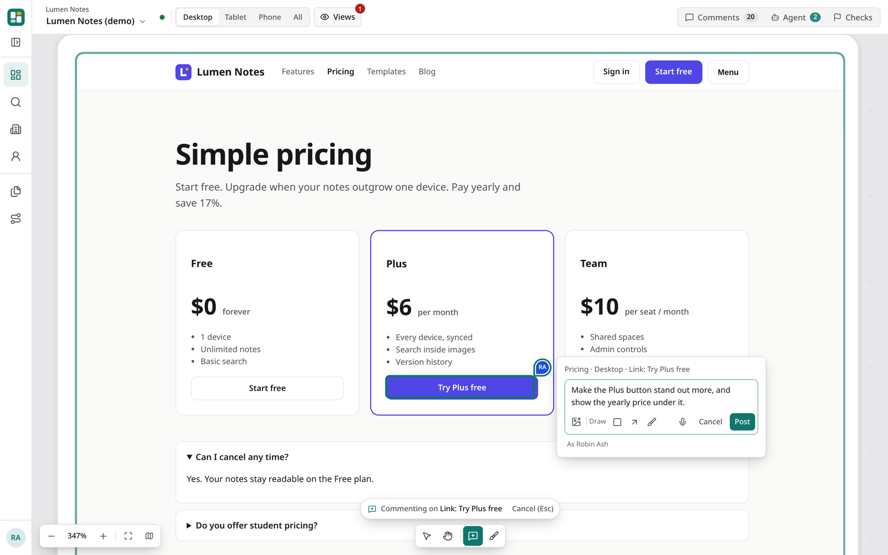

# Shapewall

[](https://www.npmjs.com/package/shapewall)
[](https://github.com/danbaruch/shapewall/actions/workflows/ci.yml)
[](#license)

**See your whole app. Steer your agents from it.**

Shapewall captures every screen of your app on desktop and phone, maps the flows between them, and lets you point at anything and tell
your agent what to build. 10 screens or 500.


When you build with coding agents, the app grows faster than you can click through it. Shapewall puts all of it on one zoomable wall:
every screen, every viewport, and the journeys between them. Pin a comment to the element you want changed and it becomes an
instruction your agent reads as JSON or over MCP. The agent changes the code, recaptures, and the wall shows before and after in place.
Built for solo builders and teams who ship with Claude Code, Codex and other agents.

**[Live demo](https://shapewall.com/demo/)** (no install) · **[Docs](https://shapewall.com/docs)** · [Changelog](CHANGELOG.md)

## Quickstart

You need Node.js 22.19 or newer (Linux, macOS or Windows) and your app running: a dev server, a preview deploy or staging. In the app's
project folder:

```sh
npx shapewall doctor --install-browser                # downloads Chromium, checks that it starts
npx shapewall init --base-url http://localhost:3000   # finds your screens, writes shapewall.config.json
npx shapewall capture                                 # every screen, desktop and phone
npx shapewall serve --open                            # the wall, on http://127.0.0.1:4600/
```

Answer `y` when npx asks to download the package, and use your app's address instead of `http://localhost:3000`. `init` reads
`sitemap.xml` if there is one, else follows the links from the home page. To pin the version for the project, run
`npm install --save-dev shapewall` first; `npx shapewall` then runs that copy.

Screens behind sign-in or app state: `shapewall auth record` saves a sign-in, and page `actions` click, fill and wait before the shot
([config](docs/config.md#capturing-an-app-not-just-its-landing-page)). On a minimal Linux (a server, a container, WSL), Chromium needs
system libraries: see [Linux system libraries](docs/deployment.md#linux-system-libraries).

## How the agent loop works

1. **Point.** On the wall, click a screen, press **Comment** (or C), click an element and say what to build. The comment pins to that
   element and follows it through the next capture. It can carry images, a drawing on the screen and dictated text.
2. **Hand off.** Your agent reads the open comments, each with its page, viewport, CSS selector, element text and screenshot path:

   ```sh
   npx shapewall comments --open --json
   ```

3. **Build.** The agent changes the code and recaptures what it touched (`npx shapewall capture --only pricing`).
4. **Report and check.** The agent replies and marks its work (`comments reply 1 --body "..."`, `comments status 1 done`). The wall shows
   the screen before and after, next to the pin; you resolve it or send it back.

To close the loop without typing commands, `shapewall watch --exec "<agent command>"` hands each new comment to your agent once, and
`shapewall mcp` is an MCP server with the same tools. The board also has a chat panel: connect an agent CLI and press **Fix with
agent** on a comment.

**Works with** Claude Code, Codex, goose, Gemini CLI and any agent that can run a shell command and read JSON, or speak MCP:

```sh
claude mcp add shapewall -- npx shapewall mcp
```

Comments are untrusted input to an agent: read [keeping an agent safe](docs/agent-hardening.md) before you let others comment.

## What else is on the wall

- **Journeys.** Name the flows people take through your screens, with forks, and step through them on desktop and phone. Agents read
  them too ([journeys](docs/journeys.md)).
- **Live HTML up close.** Zoomed out you see screenshots; zoomed in, a screen becomes its captured HTML, responsive CSS intact and every
  script stripped, framed in a sandbox ([security model](https://shapewall.com/docs/security)).
- **Before, after and environments.** Every recapture keeps history with changed pixels in red. Put staging beside production, or a
  branch preview beside the original ([compare](https://shapewall.com/docs/compare)).
- **Pull requests.** `shapewall init --ci` writes a GitHub Actions workflow that comments "4 of 23 pages changed" on each pull request
  ([pull requests](docs/pull-requests.md)).
- **Teams.** `shapewall hosted` runs a self-hosted team server (beta): sign-in, workspaces with roles, share links and connected agents
  ([where to run](docs/where-to-run.md), [hosted guide](docs/hosted.md)).
- **Local and small.** Data is plain files (JSON, PNG, HTML) in `.shapewall/`. No account and no usage data collected; error reports are opt-in and off by default. The board works on a phone too.

| A comment on an element, in live HTML                                                                                                                                                                       | On a phone, staging beside production                                                                                                                                         |
| ----------------------------------------------------------------------------------------------------------------------------------------------------------------------------------------------------------- | ----------------------------------------------------------------------------------------------------------------------------------------------------------------------------- |
|  |  |

## Try the demo locally

```sh
git clone https://github.com/danbaruch/shapewall.git
cd shapewall
npm ci                                           # installs the locked dependencies and builds the board
node bin/shapewall.js doctor --install-browser
npm run demo                                     # captures the bundled demo app and serves its wall
```

Then open http://127.0.0.1:4600/. `npm run demo -- --full` captures all 26 pages of that small notes app. The [live demo](https://shapewall.com/demo/) shows a bigger one, Brackwell: 146 screens and eight journeys.

## Docs

- [Getting started](https://shapewall.com/docs/getting-started) and the [FAQ](https://shapewall.com/docs/faq)
- [Config reference](docs/config.md): every key in `shapewall.config.json`
- [Agent workflow](docs/agent-workflow.md) and [agent recipes](docs/agent-recipes.md)
- [CLI reference](https://shapewall.com/docs/cli): every command and option (`shapewall --help all` prints the same)
- [Running and sharing a board](docs/deployment.md): your other devices, Docker, static export, CI
- [All guides](docs/README.md)

## Contributing

Issues and pull requests are welcome. Read [CONTRIBUTING.md](CONTRIBUTING.md) and the [Code of Conduct](CODE_OF_CONDUCT.md). Security
reports: [SECURITY.md](SECURITY.md).

## License

Shapewall has two licenses:

- **Apache 2.0** ([LICENSE](LICENSE)) for everything except `src/hosted`: the CLI, capture, the board, local accounts, shared helpers,
  MCP, the agents and the clients of the team server (`push`, `share`, `--remote`, in `src/remote`). Open source.
- **Functional Source License 1.1, Apache 2.0 future license** ([src/hosted/LICENSE.md](src/hosted/LICENSE.md)) for the self-hosted
  team server in `src/hosted`. Source-available: you can read, modify and run it for yourself or your company, but not offer it as a
  competing commercial service. Each release becomes Apache 2.0 two years later.

Copyright Dan Baruch and Shapewall contributors. See [NOTICE](NOTICE) and [THIRD_PARTY.md](THIRD_PARTY.md).
