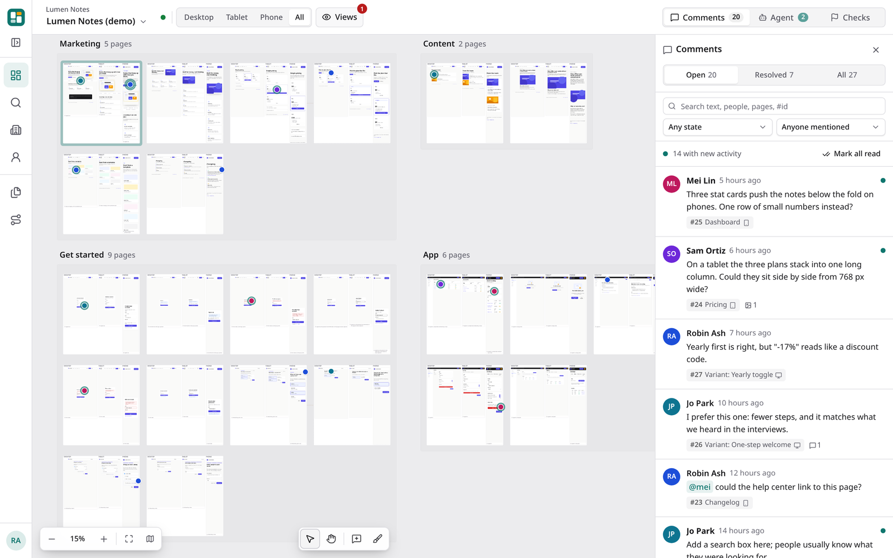
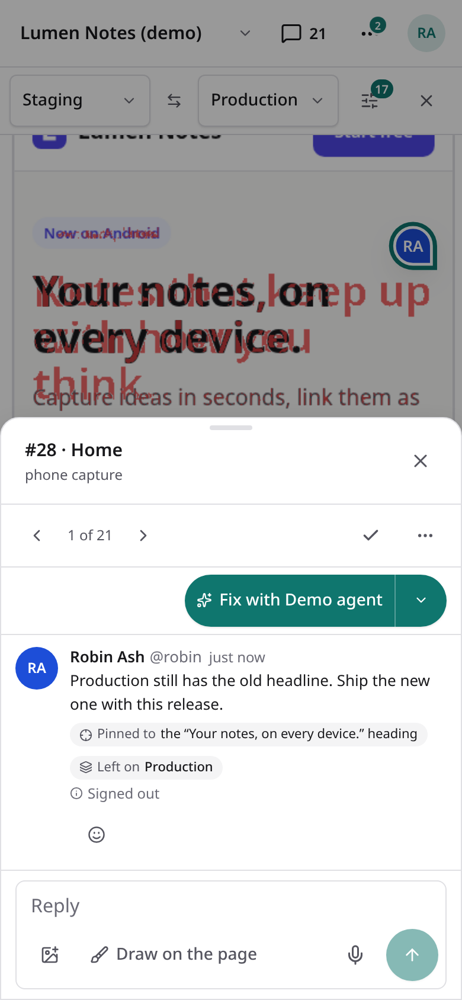
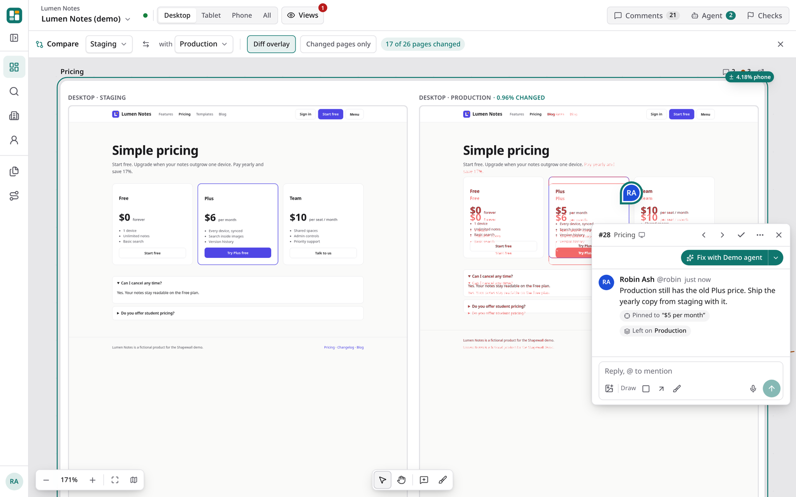

# Shapewall

[](https://www.npmjs.com/package/shapewall)
[](https://github.com/danbaruch/shapewall/actions/workflows/ci.yml)
[](#license)

**Every page of your site on one zoomable wall, with comments pinned to elements that your coding agent can act on.**



Shapewall captures each page of a running site at desktop and phone width and lays them out on one canvas. You pin a comment to the
element that needs work. A coding agent reads the comment as JSON, fixes the code, and the next capture shows whether it worked.

**[Live demo](https://shapewall.com/demo/)** (no install; comments you add stay in your browser) ·
**[Docs](https://shapewall.com/docs)** · [Changelog](CHANGELOG.md)

## Requirements

- **Node.js 22.19 or newer**, on Linux, macOS or Windows. Linux is the primary tested platform. Check with `node -v`.
- **Chromium for captures.** The first command below downloads it. To use a Chrome you already have instead, set
  `"browser": { "channel": "chrome" }` in the config.
- **A running site**: your dev server, a preview deploy, staging or production.
- **On a minimal Linux** (a server, a container, WSL), Chromium also needs system libraries. See
  [Linux system libraries](#linux-system-libraries).

## Quickstart

With your site running, in its project folder:

```sh
npx shapewall doctor --install-browser                # downloads Chromium, checks that it starts
npx shapewall init --base-url http://localhost:3000   # writes shapewall.config.json with your pages
npx shapewall capture                                 # every page, desktop and phone
npx shapewall serve --open                            # the board on http://127.0.0.1:4600/
```

The first `npx shapewall` asks to download the package ("Ok to proceed? (y)"): answer `y`. Replace `http://localhost:3000` with
your site's address. `init` reads `<address>/sitemap.xml` if there is one, else follows the links from the home page (two levels
deep, up to 25 pages, same site only).

To pin one version for everyone on the project, add it as a dev dependency first (in an empty folder, run `npm init -y` before):

```sh
npm install --save-dev shapewall
```

`npx shapewall` then runs that copy. The rest of this README shortens the command to `shapewall`.

### Linux system libraries

A Linux desktop usually has what Chromium needs. On a minimal install, `doctor` says "Playwright Chromium does not start". Install
the libraries once, as root (put `sudo` in front if you are not root), then run `npx shapewall doctor --install-browser` again.

On Debian and Ubuntu (in the project, if Shapewall is installed there, so the Playwright version matches; `doctor` prints the exact
command):

```sh
npx playwright install-deps chromium
```

On Fedora, that command fails because it needs `apt-get`. Use `dnf`:

```sh
dnf install nss atk at-spi2-atk cups-libs libxkbcommon libXcomposite libXdamage libXrandr mesa-libgbm pango alsa-lib
```

On any other distribution, the simplest answer is the official Playwright Docker image, which has Chromium and every library it
needs. Capture inside it, in your project folder (the image's version matches Shapewall's Playwright, 1.64.1):

```sh
docker run --rm --ipc=host --network host -v "$PWD":/work -w /work mcr.microsoft.com/playwright:v1.64.1-noble \
  npx shapewall capture
```

`--network host` lets it reach a site on your localhost. The board itself (`npx shapewall serve`) runs on the host as usual.

Or install the same libraries with the system package manager. The repository's own `Dockerfile` is based on that image too
([In Docker](docs/deployment.md#in-docker)).

## What to do next

### Comment

On the board, click a page and press **Comment** on the bar above it (or press C), click an element, and write what should change.
Zoomed in, the page is the captured HTML itself, so the comment pins to that element and follows it through the next capture.
Comments can carry images, a drawing on the page and dictated text. From the terminal:

```sh
shapewall comments selectors --page pricing --text Plus       # find a selector on the latest capture
shapewall comments add --page pricing --selector 'button[data-testid="plus"]' --body "Make this button bigger"
shapewall comments                                            # the open comments
```

### Hand comments to your coding agent

Any agent that can run a shell command and read JSON can work from Shapewall:

```sh
shapewall comments --open --json
```

Each comment comes with its page, viewport, CSS selector, element text, position and screenshot path. The agent fixes the code,
recaptures what it touched (`shapewall capture --only pricing`), then reports back:

```sh
shapewall comments reply 1 --body "Bigger button"
shapewall comments status 1 done        # or needs-human, with a question
shapewall comments resolve 1 --note "Bigger button"
```

To close the loop without typing commands, `shapewall watch` hands each new comment to your agent once, and `shapewall mcp` is an
MCP server with the same tools (`claude mcp add shapewall -- npx shapewall mcp`). The board also has a chat panel: **Connect** next
to an agent CLI it finds on your machine (Claude Code, Codex, goose, Gemini CLI) or an OpenAI-compatible endpoint, then press
**Fix with agent** on a comment. Guides: [agent workflow](docs/agent-workflow.md), [agent recipes](docs/agent-recipes.md),
[chat with an agent](docs/agents.md), [a sandboxed agent for shared boards](docs/starter-agent.md), and
[keeping an agent safe](docs/agent-hardening.md) (comments are untrusted input).

### Share the board

`shapewall serve` listens on 127.0.0.1 only and has no login.

- **Your other devices:** `shapewall serve --tailscale` serves it over HTTPS on your tailnet, and you pair each device.
- **A read-only copy:** `shapewall export` writes a static copy any web host can serve.
- **A team:** `shapewall hosted` runs a team server (beta) on a machine you choose: passkey or tailnet sign-in, workspaces with
  roles, share links, live presence, and connected agents (`shapewall agent connect`). See [where to run Shapewall](docs/where-to-run.md)
  and the [hosted guide](docs/hosted.md).

More in [deployment](docs/deployment.md).

### Try the demo board

```sh
git clone https://github.com/danbaruch/shapewall.git
cd shapewall
npm ci                                           # installs the locked dependencies and builds the board
node bin/shapewall.js doctor --install-browser
npm run demo                                     # captures the bundled demo site and serves its board
npm run demo -- --full                           # the whole fictional product, as in the live demo
```

Then open http://127.0.0.1:4600/. In the full demo the Status page answers 404 on purpose and is captured as an expected error page
(`"expectStatus": 404`), so the run ends with every shot ok.

## What else it does

- **Live HTML up close.** Zoomed out you see screenshots; zoomed in, a frame turns into a self-contained HTML snapshot of the page,
  responsive CSS intact, with every script stripped. It runs no JavaScript: it is sanitized at capture, served with a strict CSP
  and framed in a sandbox ([security model](https://shapewall.com/docs/security), [architecture](docs/architecture.md)).
- **Before and after.** Every recapture keeps the previous shot, so a resolved comment shows before and after near its pin, and each
  page keeps its history with the changed pixels in red.
- **Compare environments and variants.** Capture staging and production and see each page in both, and comment on either side:
  the pin stays with the environment it was left on. Put a branch preview or a redesign beside the original
  ([before, after and staging](https://shapewall.com/docs/compare)).
- **Journeys and links.** Name the path people take through your pages and step through it; see the links each capture found
  ([journeys](docs/journeys.md)).
- **Signed-in pages, menus, app states.** `shapewall auth record` saves a sign-in; page `actions` click, fill and wait before the
  shot ([config](docs/config.md)).
- **Capture on pull requests.** `shapewall init --ci` writes a GitHub Actions workflow that comments "4 of 23 pages changed" on each
  pull request ([pull requests](docs/pull-requests.md)).
- **GitHub, notifications, checks.** A comment becomes a GitHub issue and resolves when its pull request merges
  ([GitHub](docs/github.md)); comment events go to a webhook, Slack, Discord or email ([notifications](docs/notifications.md));
  page checks and Lighthouse audits ([page checks](docs/page-checks.md)).
- **Works on a phone.** The board is a PWA with 44 px touch targets and a bottom sheet for comments.
- **Small and local.** Node, Playwright, Express, React Flow. Data is plain JSON files in `.shapewall/`. No account, no telemetry.

| A new comment on an element, in live HTML                                                                                                     | On a phone, comparing staging with production                                                                      |
| --------------------------------------------------------------------------------------------------------------------------------------------- | ------------------------------------------------------------------------------------------------------------------ |
|  |  |



## Reference

- [Getting started](https://shapewall.com/docs/getting-started): each step above in more detail.
- [Config reference](docs/config.md): every key in `shapewall.config.json`.
- [CLI](#cli): every command and option, below.
- [FAQ](https://shapewall.com/docs/faq): single-page apps, signed-in pages, where the data lives, Firefox, licenses.
- [All guides](docs/README.md): agents, hosting, updates, local accounts, capture warnings, Buzz and more.

## CLI

The commands you will use most:

```text
shapewall init [--base-url URL] [--sitemap [URL|FILE]]      write shapewall.config.json
shapewall auth record                                       sign in by hand and save the session for captures
shapewall capture [--only ID|PATH ...] [--env ID] [--json]  capture pages and check their links
shapewall serve [--open] [--tailscale] [--accounts]         the board, on http://127.0.0.1:4600/
shapewall comments [--open|--resolved|--all] [--json]       feedback for you or a coding agent
shapewall comments add|reply|status|resolve|reopen|delete   add a comment, or what the agent reports back
shapewall watch [--exec "CMD ARGS"] [--mention NAME]        hand each new comment to an agent
shapewall mcp                                               MCP server for coding agents
shapewall checks | audit                                    page checks and Lighthouse lab audits
shapewall export [--out DIR]                                a static, read-only copy
shapewall hosted | share | login | push                     the self-hosted team server and its clients
shapewall doctor [--install-browser]                        check the setup
```

`--config FILE` works with every command, and `shapewall <command> --help` prints one command's options. An option a command does not
take is an error with a "did you mean" hint.

<details>
<summary>Every command and option (<code>shapewall --help</code>)</summary>

```text
Usage: shapewall <command> [options]

Commands
  buzz-bridge               run a private foreground gateway to existing Buzz agents
      --bridge-config FILE  private operator map outside project/capture data; Ctrl-C stops it
                            no new agent, session, model, or automatic completion (docs/buzz.md)
  settings                  open temporary host-only agent settings (no board or chat)
      --port N             loopback port (default: a free port)
      --open               open the private settings link in your browser
  auth record               open a fresh browser for manual capture sign-in
      --board ID            board to sign in to (default: the first)
      --env ID              environment to sign in to (default: the first)
      --url URL             optional sign-in page (never printed)
      --timeout SECONDS     time to finish (default 600, maximum 1800)
      --overwrite           explicitly replace this board/environment's saved state
                            press Enter to save; Ctrl-C, browser close or timeout discards
                            saves a private .shapewall-auth/*.auth.json; config stays unchanged
  init                      write shapewall.config.json in this folder
      --base-url URL        the site to capture (default http://localhost:3000); finds its
                            pages: <base URL>/sitemap.xml, else links from the home page
                            (2 levels, 25 pages, same site only)
      --sitemap [URL|FILE]  take the pages from this sitemap instead
                            (alone: <base URL>/sitemap.xml)
                            (with --limit, --group, --exclude as for sitemap)
      --no-discover         do not look for pages: write the home page only
      --force               overwrite an existing config
      --ci                  write .github/workflows/shapewall.yml (capture on every pull request) beside
                            the config; an existing config is kept, --force replaces only the workflow
  sitemap [URL|FILE]        add the pages of a sitemap.xml (or sitemap index) to the config
                            (default: the board's "sitemap" setting)
      --limit N             at most N new pages, the shallowest first (default 100)
      --group NAME          put them all in one group (default: by first path segment)
      --exclude /PREFIX     leave out paths starting with this (repeat or comma-separate)
      --board ID            board to add them to (default: the first)
      --dry-run             show what would be added, change nothing
      --json                machine-readable result
  capture                   capture every page (desktop + phone, PNG + live HTML) and check its links
      --board ID            board to capture (default: the first)
      --only ID|PATH        only these pages (repeat or comma-separate)
      --env ID              capture this environment (default: the first)
      --check-external      also check links to other sites (default: same-site links only)
      --json                machine-readable summary on stdout (shots, failures, broken links); progress on stderr
      -y, --yes             never ask anything (capture does not prompt; for CI scripts)
                            exit code: 0 all shots ok, 2 some failed (an "expectStatus" page is ok), 1 error
  checks [run|list]         check original pages and save private diagnostic reports
  checks flow --flow-file FILE    run one explicit interaction flow, with an optional final accessibility snapshot
  checks accessibility --only ID [--viewport NAME]    audit one original page state with axe
      --board ID            board to check (default: the first)
      --env ID              environment to check (default: the first)
      --only ID|PATH        only these pages (repeat or comma-separate)
      --seo | --no-seo      include public SEO and social-image checks, or leave them out when the config turns them on
      --limit N             maximum page views to check (default 20)
      --source-build SHA    source revision for report provenance
      --json                machine-readable reports; progress on stderr
  audit [board]             run bounded Chrome Lighthouse lab audits on original pages
      --board ID            board to audit (default: the first)
      --env ID              environment to audit (default: the first)
      --only ID             only these page ids (repeat or comma-separate)
      --viewports NAMES     configured viewport names, comma-separated
      --samples N           repeated samples per view (default 1, maximum 10)
      --max-pages N         explicit page cap (default 5, maximum 20)
      --max-runs N          explicit navigation cap (default 10, maximum 40)
      --cache MODE          cold, warm or auth-preserved
      --production MODE    production, development or unknown
      --source-build SHA    source build identifier for provenance
      --browser-version V   require this installed browser version
      --seo | --no-seo      include optional Lighthouse SEO checks, or leave them out when the config turns them on
      --json                machine-readable reports; progress on stderr
  serve                     serve the board (http://127.0.0.1:4600/ by default)
      --port N              default 4600
      --host ADDR           default 127.0.0.1 (see docs/deployment.md before changing)
      --tailscale[=print]    private HTTPS over Tailscale; =print changes nothing
      --no-identity         pair even devices signed in as the Tailscale owner
      --lan[=IP|INTERFACE]   pair devices on your network (HTTP cookies can be sniffed)
      --tls-cert FILE       with --lan: HTTPS certificate (also --tls-key FILE)
      --no-remote-chat      paired devices cannot use the agent
      --approve-on-host     paired devices cannot approve agent commands
      --open                also open the board in your browser, with agent settings
      --read-only           no comments or captures from the UI
      --accounts            require local passkey accounts after owner setup (Node 22.19+)
      --accounts-origin URL fixed HTTPS origin (default: loopback URL or --tailscale URL)
      --no-capture          comments allowed, captures only from the CLI
      --buzz-bridge FILE    owner-only existing Buzz conversation (private operator map; docs/buzz.md)
      --allowed-host NAME   extra Host header to accept (repeatable; also $SHAPEWALL_ALLOWED_HOSTS, "*" = any)
      --chat | --no-chat    the board chat with your agent (default on, off when shared beyond this machine)
      --agent-acp "CMD"     chat with an agent CLI over ACP, e.g. "claude-agent-acp" (installed globally)
                            (also $SHAPEWALL_AGENT_ACP; never read from the config; docs/agents.md)
      --allow-remote-agent  with --chat on a shared board, let an ACP agent run anyway (anyone reaching it acts as you)
  devices list              paired devices and pending requests for this project [--json]
  devices approve CODE      approve after matching the code on your device
  devices deny CODE         deny a pending request
  devices revoke ID|--all   revoke a device or all devices immediately
  comments [list]           print comments (feedback for you or a coding agent)
      --open | --resolved | --all   which ones (default --open)
      --page ID             only comments on this page
      --mention NAME        only comments that mention @NAME (in the text or a reply)
      --since ID|TIME       only comments after this comment id, or created or changed after this ISO time
      --json                machine-readable, with selectors, file paths and replies
      --for-agent           each comment quoted as untrusted data (<shapewall-data>), for an agent to read
  comments get ID           one comment, everything about it   [--json] [--for-agent]
  comments add              add a comment   --page ID --body TEXT [--viewport NAME (default the page's first)]
                            [--selector CSS (pin it to that element)] [--author NAME (default agent)] [--json]
  comments selectors        the selectors --selector takes, with each element's text, from the latest capture
                            --page ID [--viewport NAME] [--text WORDS (only elements whose text has them)] [--json]
  comments resolve ID       mark a comment resolved   [--note TEXT] [--ref URL|COMMIT] [--author NAME] [--json]
  comments reopen ID        reopen a comment   [--author NAME] [--json]
  comments reply ID         add a reply   --body TEXT [--author NAME (default agent)] [--json]
  comments status ID S      agent status: queued, working, done, needs-human or clear   [--note TEXT] [--author NAME] [--json]
  comments delete ID        delete a comment, its replies and its images for good; asks first
                            [--yes (do not ask; needed without a terminal)] [--json]
      --board ID            board (default: the first); --remote URL for a hosted board (see push)
  events                    comment events from every process (the shared log); never claims anything
      --follow              keep printing new events until Ctrl+C
      --since ID|TIME       after this event id (from --json) or ISO time
      --limit N             without --follow or --since: the last N (default 20)
      --json                one JSON line per event   [--board ID]
  journeys [list]           print the board's journeys, with every fork and branch
      --json                machine-readable: steps (forks included), pages and every path
  links                     links between the board's pages, from the last capture
      --broken              only links that lead to an error (4xx/5xx or no answer)
      --board ID | --env ID | --json
  watch                     hand each new open comment to an agent (runs until Ctrl+C)
      --exec "CMD ARGS"     run this command per comment (comment JSON on stdin; no shell)
                            without --exec, print one JSON line per comment and mark it queued
                            (the reader sets its status with "comments status"; --no-claim marks none)
      --concurrency N       commands at once, 1 to 4 (default 1)
      --recapture           recapture the comment page after a successful --exec (local only)
      --new-only            skip comments that exist when the watch starts
      --once                hand out what is open now, wait for the commands, exit
      --timeout MIN         stop a command after this many minutes (default 60)
      --mention NAME        only comments that mention @NAME, e.g. --mention agent
      --no-claim            hand out every open comment once without claiming it (no agent status, beside other watchers)
                            a command that exits 0 must reply or set a status itself, else the
                            comment becomes needs-human (docs/agent-workflow.md)
  agent connect             make this machine's coding agent an agent of a hosted project: members chat with it
                            on the board, and it reads this folder and answers. Read and answer only unless this
                            machine says more (--approvals). The first run is approved in the browser by an admin.
                            --remote URL
      --agent NAME          which agent: claude, or a saved agent's id that runs Claude Code (default: this
                            project's agent, else Claude Code when found). Codex, goose and Gemini CLI are not
                            offered in this release. Never a command from the server
      --name "Builder"      the name to suggest on the approval page (the approver has the last word)
      --project SLUG        on a server with tailnet sign-in, run on a tailnet machine: no browser, your tailnet
                            user approves it. --project (and --workspace NAME) pick the project when there are
                            several; --used-by owner|trusted who may send it work (default owner: only you);
                            --icon NAME and --tint NAME as on the approval page
      --as NAME             a second connection from this machine (its own token; default "default")
      --audience owner|server  "owner": the server keeps it to the person who connects it even if its audience
                            there is widened, and this machine refuses a job the server says is someone else's
                            (no protection from a server that lies); "server" (default): its audience on the server
      --approvals none|owner|admins  edits from the board. "none" (default): never. "owner": the person who
                            connected it may allow each edit on the board. "admins": whoever the server lets
                            answer (admins by default). A fix is made on a new branch in a folder of its own,
                            never in this checkout. Saved for this connection; the server cannot widen it
      --allow-command "CMD" one exact command the agent may ask to run, each time allowed on the board (adds to
                            the list; "none" empties it). Default: no commands at all. Not for Claude Code in
                            this release: with its shell tool it runs read-only commands without asking
      --auto none|edits|commands|edits,commands  what the server's "allow without asking" rule may apply to
                            (default none). Never a file that runs something. Such a fix stays on this machine:
                            it is pushed only after a person allows "Push this fix" on its whole diff. With
                            --approvals owner, only the person who connected it can switch the rule on
      --allow-path FILE     a file that runs on install, build, test or CI (a dotfile, package.json, a Makefile,
                            a *.config.js, a script, a test, CI config) the agent may ask to edit; such edits are
                            refused otherwise, a named one is always asked, and a fix that changes one is never
                            pushed (adds to the list; "none" empties it)
      --base BRANCH         the branch a fix starts from (default "head": the commit this checkout is on, and
                            then only while it has no uncommitted changes)
      --git-remote NAME     where a finished fix is pushed (default origin; "none": never pushed). A pull request
                            is opened when GitHub connect is set up here (docs/github.md)
      --takeover            close the link another machine holds for this agent, and take its place
      --concurrency N       answers at once, 1 to 4 (default 2)
      --token-file FILE     for a service: the agent's own token, no browser (docs/hosted.md)
  agent run --comment ID    the sandboxed starter agent on one comment: a container with only a fresh
                            worktree, egress to the package registry only (the model is called from here), a branch
      --pr                  also push the branch and open a pull request (GitHub connect); not when it
                            touches CI config, manifests or build files unless --allow-ci-push
      --git-remote NAME     the git remote --pr pushes to (default origin; never from the config)
      --fork-remote NAME    push to your fork (a git remote) instead, and open the PR from it
      --retry               take a comment whose agent status is done or needs-human too
      --trust-comment       run a comment the trigger gate holds back (never a guest's)
      --max-turns N | --max-tokens N | --max-minutes N   budget for this comment
      --max-disk SIZE       disk cap on the checkout (default 2g; the run stops over it)
      --model-timeout S     seconds a model call may take to start answering, 1 to 900 (default 180 for
                            the first call, 60 after; tried once more on a timeout)
      --trusted NAME        may dispatch work (repeatable; adds to starterAgent.trusted)
      --runtime podman|docker   --image NAME   --profile openai-compatible
      --allow-host HOST[:PORT]  extra egress host (repeatable)   --registry HOST|none
      --work-dir DIR        where worktrees go (default: the cache folder)
  agent watch               run the starter agent on each comment the trigger gate lets through   [--once]
  agent doctor              check the runtime, image, model, trust lists and the sandbox itself   [--no-egress]
  agent build-image         build the agent's image from this package's Dockerfile.agent
      --runtime podman|docker   --image NAME (default localhost/shapewall-agent:latest)
                            (docs/starter-agent.md; --remote URL works for run and watch)
  github issue ID           open a GitHub issue from a comment (or show the one it has)
  github link ID PR         link a pull request (12, #12 or its URL) to a comment
  github sync               link pull requests that name a comment; resolve comments whose PR merged
                            (repo: "github.repo" in the config; token: $SHAPEWALL_GITHUB_TOKEN or $GITHUB_TOKEN,
                            else a signed-in GitHub CLI ("gh auth token"))
  ci capture-compare        capture before and after, compare every page and viewport, write a result
                            folder: summary.json, summary.md (the comment), images of changed shots
      --base-url URL        before (default: the board's baseUrl)   --head-url URL   after
      --base-dir DIR        or compare two capture folders   --head-dir DIR
      --out DIR             the result folder (default shapewall-ci)
      --threshold RATIO     share of pixels below which a shot is unchanged (default ci.threshold, 0.00001)
      --max-pages N         compare at most N pages (default ci.maxPages, 50)
      --fail-on-change      exit 3 when something changed, 4 when not everything could be compared (default: always 0)
  ci capture --out DIR      capture one side into a folder, from --url URL, or with --allow-start
      --allow-start         run ci.start (install, build, serve; argv arrays, no shell) in --checkout DIR
                            and capture its url; only inside a CI job (GITHUB_ACTIONS or CI is "true")
  ci comment                post or update the one pull request comment from a result folder
      --dir DIR             the result folder (default shapewall-ci)
      --artifact-url URL    link to the workflow artifact with the images
      --repo OWNER/NAME | --pull N   default: from the pull_request event
                            token: $GITHUB_TOKEN; a fork's pull request gets the job summary instead
  ci enabled                is it on for this pull request (ci.enabled, [skip shapewall] in the title)?
                            writes enabled=true|false to $GITHUB_OUTPUT
  ci wait --url URL         wait until a deploy preview answers   [--timeout SECONDS (default 600)]
      --board ID | --json   (docs/pull-requests.md)
  mcp                       MCP server on stdio for coding agents
      --read-only | --no-capture
  notify list               notification channels, their events and what each still needs   [--json]
  notify test CHANNEL       send a test message to one channel   [--to EMAIL for email channels]
  doctor                    check Node, the browser, the config, the port, the output folder, notifications and chat
      --install-browser     download the Chromium this Shapewall needs first (no config needed for this)
      --port N              port to check (default 4600)
      --no-launch           find the browser and the ACP agent without starting them
      --agent-acp "CMD"     the ACP agent to check: starts it, does the handshake, stops it (also $SHAPEWALL_AGENT_ACP)
      --json                machine-readable report
  variant add PAGE          capture another version of a page beside it
      --url URL | --path /p the version to capture (path is on the board's baseUrl)
      --title TEXT          [--note TEXT] [--source TEXT] [--id ID] [--viewport desktop,phone]
                            the id is --id, else the title as a slug plus 4 random characters
  variant rm ID | variant list
  export                    static read-only copy of the boards
      --include-checks      explicitly include private diagnostic reports
      --out DIR             default shapewall-export
      --no-comments         leave comments out
      --browser-comments    visitors may comment; their comments stay in their own browser
      --noindex             ask search engines not to index the export
  share --remote URL        move local captures, history and comments to a shared project
      --include-checks      explicitly include private diagnostic reports
      --board ID            move only this board (default all)
      --dry-run             show counts; sends nothing
      --no-comments         captures, history and journeys only

Hosted Shapewall (docs/hosted.md)
  login --remote URL        get a project token through the browser; saved for the --remote commands
      --project SLUG        on a server with tailnet sign-in, run on a tailnet machine: no code and no browser,
                            your tailnet user approves it (if its role may). --project, and --workspace NAME
                            when you are in several, pick the project; with one project neither is needed
  join --remote URL         join a workspace on a server with tailnet sign-in, from a tailnet machine: takes the
                            invite an admin made for your tailnet login. The role is the invite's
      --invite LINK         an invite link (or its code) instead
  admin projects list|create NAME | members list | agents list | invites create
                            a few admin commands on a server with tailnet sign-in, as your tailnet user (the
                            server checks your role). --remote URL; --workspace NAME when you are in several
      --login LOGIN         invites create: for one tailnet login (ada@example.com); or --link for a link
      --role ROLE           viewer, member (default), admin or owner; --days N until it expires; --name; --json
  push                      upload the latest captures to a hosted project
      --include-checks      explicitly include private diagnostic reports
      --remote URL          the hosted Shapewall (or $SHAPEWALL_REMOTE)
      --board ID            only this board (default: every board)
  comments | watch | mcp --remote URL
                            the same commands against a hosted board (--board ID picks one)
                            token: $SHAPEWALL_TOKEN or --token-file FILE (a project token, swp_...)
                            watch --exec commands get no token unless --pass-token
                            watch and mcp show on the board as an agent, by the token's name
      --include-guests      comments and watch: also share link guests' comments (untrusted)
  hosted                    run the hosted server (accounts, workspaces, pushed boards)
      --data DIR            default ./shapewall-hosted-data (or $SHAPEWALL_HOSTED_DATA)
      --origin URL          public origin, e.g. https://app.example.com (default http://HOST:PORT)
      --port N | --host ADDR   default 4700 on 127.0.0.1
      --signup invite|open  default invite (the first account uses the setup link)
      --trust-proxy         behind a reverse proxy on this host (client IPs from X-Forwarded-For)
      --usercontent-origin URL  serve live HTML only from this other origin (or $SHAPEWALL_USERCONTENT_ORIGIN)
      --previous-origin URL while moving to a new origin: the old one (sign-in moves, up to 30 days)
      --report-email ADDR   where "Report this board" on public projects goes
      --owners-see-sign-ins workspace owners see their members' sign-ins and devices in Activity
                            (off: each person sees only their own; for a server with one team)
      --tailscale           on your tailnet through tailscale serve (https://<machine>.<tailnet>.ts.net)
      --tailscale-port N    default 443; --funnel: share links public through Tailscale Funnel
                            (share pages only, never the console), on --funnel-port 8443|443|10000
      --tailnet-sign-in     with --tailscale: a tailnet user is signed in as the account linked to their tailnet
                            login, no passkey (or $SHAPEWALL_HOSTED_TAILNET_SIGN_IN=1). An admin still decides
                            who is in a workspace. Needs Linux and Tailscale 1.98+ in its normal (TUN) mode, not
                            in a container; refuses to start where it cannot prove that a request came through
                            tailscale serve. An identity is per device: what runs as you there can act as you.
                            Tailscale is then the only sign-in: no passkeys, and the few things that always ask
                            take a typed confirmation
      --tailnet-passkeys    with --tailnet-sign-in: also allow passkeys ($SHAPEWALL_HOSTED_TAILNET_PASSKEYS=1, or
                            hosted admin passkeys on|off). An account that adds one confirms with it
      --quotas FILE         per-workspace quotas (default <data>/quotas.json when it exists)
      --retention-hours N   prune old versions every N hours (default 6, 0 = off); --retention-keep N (2)
  hosted setup-link         print the first account's one-time link (it is not in the log)
  hosted claim --data DIR --login LOGIN
                            with --tailnet-sign-in: make the first account on the server's own machine, no
                            browser. Whoever can read the data folder says whose server it is: --login is the
                            owner's tailnet login (ada@example.com); --workspace-name NAME. From another tailnet
                            device: hosted claim --setup-link URL (the server then sees who asks)
      --data DIR | --new    --new: make a new link (the old one stops working)
  hosted move-origin --to URL   move the server to a new origin (passkeys move with a rebind)
      --data DIR | --days N | --status   window 1 to 30 days (default 30)
  hosted --setup --domain HOST   write a Docker Compose + Caddy folder for your own domain
      --usercontent-domain HOST  live HTML on its own domain; --email (TLS); --dir (./shapewall-hosted)
      --source DIR          a Shapewall checkout to build from; --dry-run; --force; --start (build, start, setup link)
  hosted admin list|suspend|resume|delete|export|reports|retention|log   the operator's commands
  hosted admin members|invites|projects|passkeys ...   who is in a workspace and how people sign in, from the
                            server's own machine (shapewall hosted admin help lists them)
  hosted backup --to DIR [--keep-days N]   a consistent copy while the server runs
  hosted restore --from BACKUP --data NEW | --from BACKUP --check (the restore drill)

Global
  --config FILE             default ./shapewall.config.json (or $SHAPEWALL_CONFIG)
  -h, --help | -v, --version   (shapewall <command> --help shows one command)
```

</details>

## Contributing

Issues and pull requests are welcome. Read [CONTRIBUTING.md](CONTRIBUTING.md) and the [Code of Conduct](CODE_OF_CONDUCT.md). Security
reports: [SECURITY.md](SECURITY.md).

## License

Shapewall has two licenses:

- **Apache 2.0** ([LICENSE](LICENSE)) for everything except `src/hosted`: the CLI, capture, the board, MCP, the agents and the clients
  of the team server (`push`, `share`, `--remote`, in `src/remote`). Open source.
- **Functional Source License 1.1, Apache 2.0 future license** ([src/hosted/LICENSE.md](src/hosted/LICENSE.md)) for the self-hosted
  team server in `src/hosted`. Source-available: you can read, modify and run it for yourself or your company, but not offer it as a
  competing commercial service. Each release becomes Apache 2.0 two years later.

Copyright Dan Baruch and Shapewall contributors. See [NOTICE](NOTICE) and [THIRD_PARTY.md](THIRD_PARTY.md).
