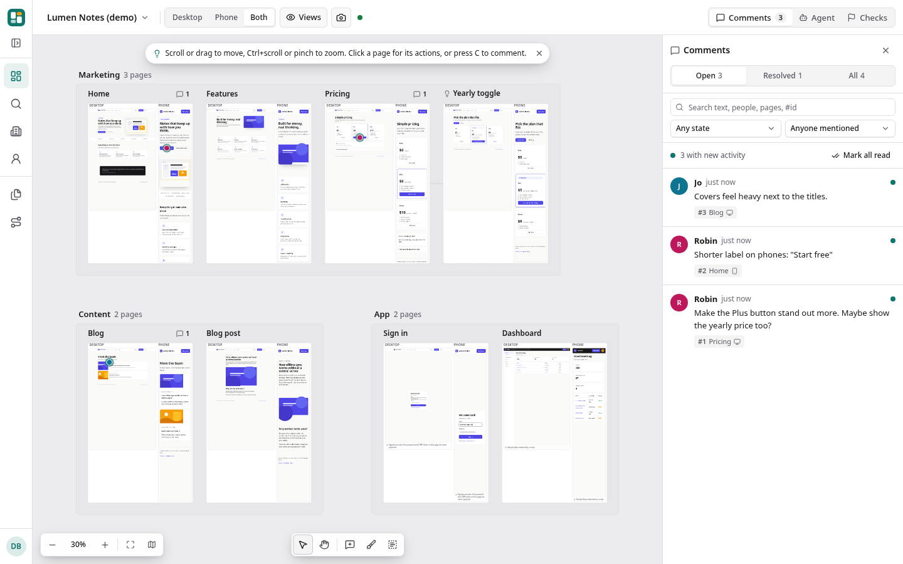
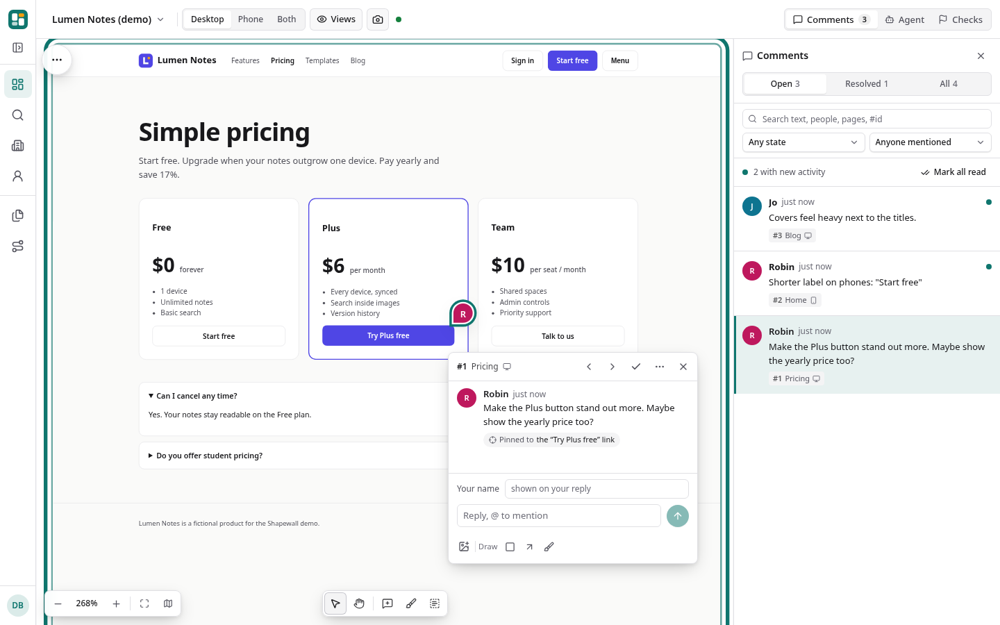
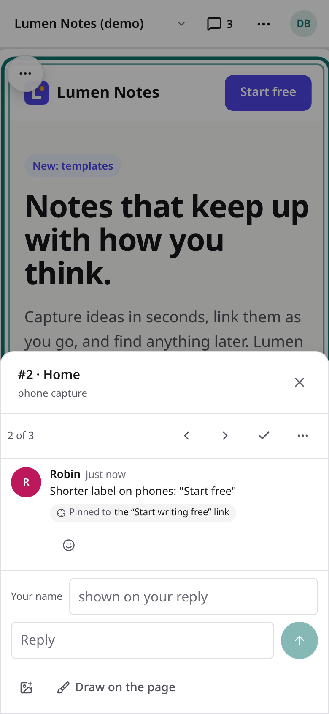
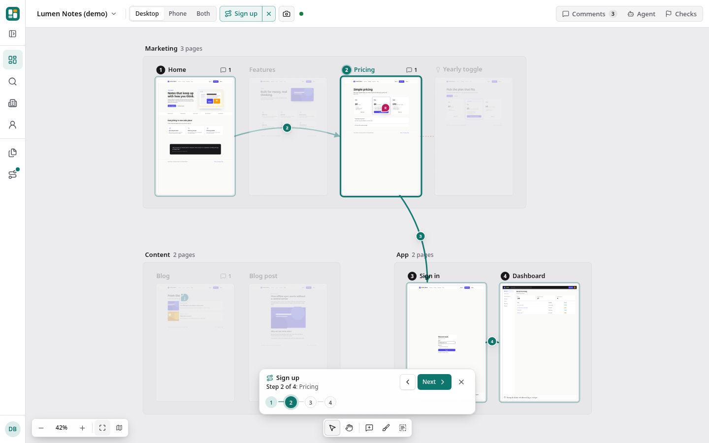
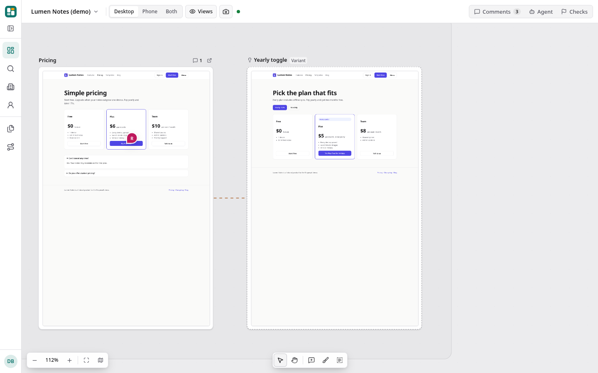

# Shapewall

[](https://www.npmjs.com/package/shapewall)
[](https://github.com/danbaruch/shapewall/actions/workflows/ci.yml)
[](#license)

**Every page of your site on one zoomable wall, with comments pinned to elements that your coding agent can act on.**



With your dev server running, in its project folder:

```sh
npx shapewall doctor --install-browser                          # once: downloads the Chromium that captures use
npx shapewall init --base-url http://localhost:3000             # your dev server: finds its pages
npx shapewall capture                                           # every page, desktop and phone
npx shapewall serve --open                                      # the board, in your browser
```

**[Live demo](https://shapewall.com/demo/)** (no install: a board of a fictional product, 26 pages, comments in every state; comments
you add stay in your browser) · **[Docs](https://shapewall.com/docs)** · [Quickstart details](#quickstart)

Shapewall captures each page at desktop and phone width, lays them out on a canvas grouped by section, and lets you pin comments to the
exact element that needs work. Zoom out to see the whole product at once; zoom in and the screenshot turns into the real, captured
HTML, with responsive CSS intact and every script stripped. Comments come out as structured JSON, so a coding agent can read the
feedback, fix the code, and you recapture to check.

- **Whole-site view.** Desktop, tablet and phone captures side by side, grouped (Marketing, App, ...), with per-page notes like
  "signed-out state". Add your own viewports, such as a landscape phone.
- **Screenshots far out, live HTML up close.** Zoomed out you see light thumbnails; zoomed in (or with "Open live") a frame swaps to a
  self-contained HTML snapshot you can select text in. It runs no JavaScript: three independent locks keep it inert.
- **Comments that stay put.** On live HTML a comment is anchored to the element under your click (a CSS selector plus its text), so after
  the next capture the pin follows the button, not the old pixel. Resolve, reopen, edit, reply in a thread, and **@mention** people or
  `@agent`. Search the comments and narrow them by state (agent working, needs a person, reopened, ...) or by who is mentioned.
- **Variants.** Put another version of a page (a branch preview, a redesign) right beside the original.
- **Journeys.** Name the path people take ("Sign up": home, pricing, sign in, dashboard) in the config or by clicking pages on the board,
  then step through it with arrows between the steps. A journey can fork ("link works" or "link expired") and rejoin; pick a branch as
  you step through. **Links** draws the links each capture found between your pages.
- **Before and after.** Every recapture keeps the previous shot, so a resolved comment shows before and after near its pin, with a link
  to the pull request or commit that fixed it.
- **Page history.** Every page keeps its earlier captures: open a page's history to see an earlier capture beside the current one,
  with the changed pixels in red and the comments that were made on each.
- **Pages from your sitemap.** `shapewall sitemap https://www.example.com/sitemap.xml` fills the page list from a sitemap (or a sitemap
  index), grouped by path, without repeats.
- **Compare environments.** Capture staging and production, then see each page in both with the changed pixels in red, and filter to the
  pages that changed.
- **Installs as an app.** The board is a PWA: add it to a phone's home screen and it opens full screen.
- **Made for the agent loop.** `shapewall comments --json` hands any coding agent the page, viewport, selector, element text, position and
  screenshot path for each open comment. `shapewall watch` dispatches new comments to your agent by itself, and `shapewall mcp` gives it
  tools. It fixes, recaptures, replies on the comment; the pins tell you if it worked.
- **Works on a phone.** 44 px touch targets, a bottom sheet for comments, and Back closes the topmost panel instead of leaving the board.
- **Agent usage you can see.** Every agent turn leaves a usage record (numbers and ids, never the question or the answer): the
  local console's Usage page shows turns, tokens, time and reported cost by day and agent.
- **Small and local.** Node 22, Playwright, Express, React Flow. Data is plain JSON files in `.shapewall/`. No account, no cloud.
- **A team server when you want one.** `shapewall hosted` adds passkey accounts, workspaces with roles, share links and live presence
  on a server you run. `shapewall agent connect` puts your Claude Code on the hosted board: teammates chat with it there, and it
  reads the project and answers. When its own machine says so (`--approvals`), it also makes a fix for a comment on a new branch,
  each edit allowed on the board. Each machine that watches a hosted board is an agent too, with a name, an
  icon and a state; people send a comment to one by name, and each agent says whose work it takes. The console's **Usage** page
  shows every agent turn with the tokens and cost each agent reported (never estimated), as charts and a grid, and **Activity**
  shows who signed in, who changed which setting and who approved what.
  [Multiplayer (beta)](#multiplayer-on-your-own-server).
- **Switch local projects.** Serve each project on its own port; the site dropdown lists them together while keeping every project's
  agent and files separate. [Several local projects](docs/deployment.md#several-local-projects).

| Live HTML with an element-anchored comment                       | On a phone                                             |
| ---------------------------------------------------------------- | ------------------------------------------------------ |
|  |  |



## Quickstart

### Requirements

- Runs on Linux, macOS and Windows with Node.js **22.13 or newer**. Linux is the primary tested platform.
- Chromium for captures: `shapewall doctor --install-browser` downloads Playwright's build, or use a Chrome you already have.
  On a bare Linux server, a container or WSL, Chromium also needs system libraries: run
  `sudo npx playwright install-deps chromium` once.

### Install

In the project you want to review, with its dev server running:

```sh
npm install --save-dev shapewall
npx shapewall doctor --install-browser         # downloads the Chromium that captures use
npx shapewall init --base-url http://localhost:3000
npx shapewall capture
npx shapewall serve --open
```

`--base-url` is your running dev server, staging or production. `init` finds its pages: `<base URL>/sitemap.xml` if there is one,
else the links on the home page (two levels deep, up to 25 pages, same site only). If the site is not up it writes just the home page
and says what to do next. `--sitemap URL|FILE` takes another sitemap; `--no-discover` skips the lookup.
In an empty folder, run `npm init -y` before the install. Without the install, `npx shapewall ...` downloads the package on first use,
as in the three lines at the top.

`npx shapewall` runs the copy installed in the project. The rest of this README shortens the command to `shapewall`.

For the latest unreleased build, install from GitHub with `npm install --save-dev github:danbaruch/shapewall` (npm clones the
repository and builds the board: about a minute), or from a clone:

```sh
git clone https://github.com/danbaruch/shapewall.git
cd shapewall
npm ci        # installs the locked dependencies and builds the board
npm link      # optional: puts `shapewall` on your PATH
```

Without `npm link`, run `node /absolute/path/to/shapewall/bin/shapewall.js` from your project. A global install straight from GitHub
(`npm install -g github:...`) fails, because npm cannot build a git package in global mode.

Good to know:

- To capture with a Chrome you already have, set `"browser": { "channel": "chrome" }` and skip `--install-browser`.
- `shapewall doctor` checks the browser (by starting it), the config, the output folder, the port and notifications.
- `init` adds `.shapewall/`, `shapewall-export/` and `*.auth.json` to `.gitignore`. Captures and saved sign-ins of a private site are
  private: keep them out of git.
- Edits to titles, pages and journeys in the config show up on the next refresh of the board, with no restart.

Next: [configuration and sign-in](docs/config.md#auth), [capture warnings and pacing](docs/capture-warnings.md),
[local accounts](docs/local-accounts.md), [updates](docs/updates.md) and [deployment](docs/deployment.md). Not sure which shape you need? [Where to run Shapewall](docs/where-to-run.md).

### Multiplayer on your own server

**Beta.** The team server is in beta: keep backups and expect changes between releases.

```sh
shapewall hosted --data ./hosted-data --tailscale --tailscale-port 8443
```

Run that on one machine. Teammates open its HTTPS address over Tailscale, sign in with their own passkeys and join a workspace you
invite them to. Captures still run on your machine: `shapewall share --remote URL` moves an existing project to the server, or `login`
and `push` upload new captures. Comments, roles, scoped agents and live presence work on the shared server. A machine that runs
`shapewall watch --remote URL` is an agent on that board, listed by name with its state; people send a comment to one agent or to
any, and each agent takes work only from the people it is shared with. `shapewall agent connect --remote URL`, run in a project's
folder, connects that machine's Claude Code for chat on the board: an admin approves it in the browser, members ask it questions
from the Agents panel, and it reads the project and answers. By default it does not change files or run commands from the board.
Edits are switched on only on the machine that has the code (`--approvals owner` or `admins`): **Fix with** on a comment then
makes the fix on a new branch there, never in the checkout, and each edit is a card with the full diff that someone allows or
denies on the board. It runs no commands from the board. Codex, goose and Gemini CLI are not offered by `agent connect` in this
release; for them, `shapewall watch --remote` stays the way ([Connected agents](docs/hosted.md#connected-agents)). You need no public domain and no Shapewall account.

The command runs in the foreground and sets up Tailscale Serve; running it as a service and backing it up are covered in
[the hosted guide](docs/hosted.md), with a [checklist to walk through before you invite the team](docs/hosted.md#before-you-invite-the-team).
`shapewall serve --tailscale` is the single-player counterpart: your own board on your other devices.

### The demo

```sh
git clone https://github.com/danbaruch/shapewall.git
cd shapewall
npm ci                                           # also builds the clients
node bin/shapewall.js doctor --install-browser   # once (no config needed); or use your installed Chrome (see Config)
npm run demo                                     # captures the bundled demo site and serves its board
npm run demo -- --full                           # the whole fictional product, as in the live demo (26 pages)
```

Open http://127.0.0.1:4600/ and try it: click a page and press **Comment** on the bar above it (or pick **Comment** in the tools at the bottom of the board, or press C), click a button on the page, write a note. Zoomed in, the page is live and the comment pins to the element you click.

## How it works

1. **Capture.** Playwright opens each page in Chromium at every viewport (default 1440x2200 desktop and 390x1800 phone; add a tablet
   or your own; fixed frames, not full-page). It waits for the network to settle, your `waitFor` selector and any `actions`, and for images in view to finish loading. It
   writes a PNG, a thumbnail of the same frame, a live HTML snapshot and its element map. Runs hold a lock, so two captures of one board never overlap; a
   full run is written to a staging folder and swapped in at the end, so a failed run keeps the previous captures.
2. **Board.** `shapewall serve` starts a small Express server (127.0.0.1 only by default) with the API and the React Flow client. The
   canvas only loads full-size images and live HTML for frames that are big enough on screen, at most two live documents at a time.
3. **Comments.** Stored in `.shapewall/<board>/comments.json`, written atomically under a file lock, so the server and the CLI can change
   them at the same time.

### How live HTML is sandboxed

A captured page is turned into one self-contained document and shown inside the board. It must never run code from the captured site, so
there are three independent layers, any one of which is enough on its own:

1. **Sanitized at capture.** The rendered DOM is cloned in the page (so client-rendered content is included), then rebuilt by a strict
   allowlist sanitizer in Node (parse5, the HTML spec parser): no `script`, `iframe`, `object`, `embed`, `base`, `link`, `template` or SVG
   animation elements; no `on*` handlers, `srcset`, `formaction` or `target`; links only `http(s)`, `mailto`, `tel` and `#`; images and
   fonts only as complete, inlined `data:` URIs; CSS without `@import`, `expression()` or remote `url()`, including when spelled with CSS
   escapes. Hidden inputs and password values are dropped, so CSRF tokens and typed secrets never reach the file. Stylesheets keep their
   `@media` rules, so the snapshot stays responsive. Images are re-encoded from the decoded pixels and identical images are stored once.
2. **Served with a strict CSP.** `default-src 'none'; img-src data:; style-src 'unsafe-inline'; font-src data:; base-uri 'none';
form-action 'none'; frame-ancestors 'self'`. No script source at all. The same policy is also embedded as a `<meta>` tag, for static
   exports where no headers are sent.
3. **Framed in a sandbox.** `<iframe sandbox="">` gives the document an opaque origin, with no scripts. Pins and click targets come
   from the captured element map, so the board never reads the frame's DOM. Only older captures without a map on a local board keep
   `allow-same-origin` until their next recapture; hosted boards and static exports always use an opaque frame.

Details and limits: [docs/architecture.md](docs/architecture.md).

## The agent loop

Shapewall is vendor neutral: any coding agent that can run a shell command and read JSON can use it.

```sh
shapewall comments --open --json > feedback.json
```

One item of its `comments` array, from the demo board (abridged):

```json
{
  "id": 1,
  "status": "open",
  "body": "Make the Plus button stand out more. Maybe show the yearly price too?",
  "author": "Robin",
  "page": { "id": "pricing", "path": "/pricing/", "title": "Pricing", "url": "http://127.0.0.1:4601/pricing/" },
  "viewport": { "name": "desktop", "width": 1440, "height": 2200 },
  "position": { "xPercent": 50, "yPercent": 27.05, "x": 720, "y": 595 },
  "element": { "selector": "a[data-testid=\"plus-cta\"]", "text": "Try Plus free" },
  "files": {
    "screenshot": "/path/to/project/.shapewall/demo/captures/pricing.desktop.png",
    "liveHtml": "/path/to/project/.shapewall/demo/captures/pricing.desktop.html"
  },
  "agentStatus": null,
  "replies": []
}
```

Then:

1. **Comment** on the board (people do this part).
2. **Fix.** Give the agent the JSON (or tell it to run the command). The selector and text point it at the element; the screenshot shows
   what the reviewer saw.
3. **Recapture** the pages it touched: `shapewall capture --only pricing`.
4. **Report.** The agent replies and marks its work: `shapewall comments reply 1 --body "Bolder button, yearly price under it"` and
   `shapewall comments status 1 done` (or `needs-human` with a question).
5. **Check** the board. Pins on live HTML follow their elements; resolve what is done, or let the agent do it:
   `shapewall comments resolve 1 --note "Bolder Plus button, yearly price under it"`.

To close the loop without anyone typing a command:

- `shapewall watch` hands every new open comment to an agent exactly once: as a JSON line on stdout, or by running your command per comment.
- `shapewall watch --exec "claude -p '...'"` (or `codex exec '...'`) gets the comment JSON on stdin, no shell involved.
- `shapewall watch --mention agent` only hands out comments that tag `@agent` (in the text or a reply), so people can talk first.
- Its status goes `queued`, `working`, then `done` or `needs-human`; a restart or a second watcher never hands one out twice.
- `shapewall mcp` is an MCP server with tools to list, read (with a crop of the screenshot), reply, set status, resolve and recapture.
- Comments can carry images and a drawing on the page; agents get both
  ([images and drawings on comments](docs/agent-workflow.md#images-and-drawings-on-comments)).
- With Shapewall installed in your project: `claude mcp add shapewall -- npx shapewall mcp`; Codex and other clients in
  [docs/agent-workflow.md](docs/agent-workflow.md).

An agent you connect on the board edits the folder the config is in, shown as **Source folder on the Shapewall computer** in Settings.
So put `shapewall.config.json` in the checkout the agent should change, and serve one project per repository. More in
[source folder and agent sign-in](docs/agents.md#source-folder-and-agent-sign-in).

### GitHub connect

Set `"github": { "repo": "owner/name" }` in the config and a token in `GITHUB_TOKEN` (or `SHAPEWALL_GITHUB_TOKEN`; never in the config).
Then a comment becomes a GitHub issue with one click (**GitHub issue** on the board, `shapewall github issue 12`, the API or MCP), with the
comment text, page URL, element, screenshot link and a link back to the board. Pull requests that say `shapewall:12` or
`Fixes shapewall#12` (or close the comment's issue) are linked to it by `shapewall github sync` or a signed webhook, and when one merges,
the comment resolves with the PR as its fix. Details: [docs/github.md](docs/github.md).

### Capture on pull requests

`npx shapewall init --ci` writes a GitHub Actions workflow. Commit it, and every pull request gets one comment, updated on each push:
"Shapewall: 4 of 23 pages changed", with each changed page and screen size, the share of pixels that changed, and the before, after and
diff images as a workflow artifact. It builds and serves both branches (`ci.start` in the config) or captures your deploy preview, never
fails the pull request, and turns off with `"ci": { "enabled": false }` or `[skip shapewall]` in a title.
Details: [docs/pull-requests.md](docs/pull-requests.md).

Prompts that work, the data shapes, and how to keep it safe (comments are untrusted input): [docs/agent-workflow.md](docs/agent-workflow.md).
Copy-paste setups for Claude Code, Codex, goose, Ollama and chat bots: [docs/agent-recipes.md](docs/agent-recipes.md).
Optional integrations: [notifications](#notifications), GitHub connect above, and a [bridge to agents in a Buzz chat](docs/buzz.md).

### Chat with an agent

The board has a chat panel: a thread for the board and one per comment, streaming answers, images (paste, drop, or a page or element
crop from the board), voice in, and read aloud with the system voice or natural voices that run in your browser (Kokoro, a
one-time download of about 90 MB; the text never leaves the browser). Connect any OpenAI-compatible endpoint with `"agent": { "baseUrl", "model" }` and the key
in `SHAPEWALL_AGENT_API_KEY` (OpenAI, DeepSeek, OpenRouter, or Ollama with no key), or an agent CLI on your machine over ACP with its
own subscription login: `shapewall serve --agent-acp "claude-agent-acp"` (also `codex-acp`, `goose acp`, `gemini --acp`). Or skip the
flags: open the board with `shapewall serve --open` and click **Connect** next to the agent CLI it found on your machine. Board text
goes to the agent as quoted data, never as instructions. Optional, on the Agents page: an agent CLI can
[work on a branch](docs/agents.md#work-on-a-branch) instead of your checkout, and
[fix several comments at once](docs/agents.md#fix-several-comments-at-once), one after another. Details: [docs/agents.md](docs/agents.md).

### The sandboxed starter agent

For shared boards, `shapewall agent run --comment 12` (or `agent watch`) works on a comment inside a podman or docker container: only a
fresh checkout of the repo (no .git) mounted, egress to the package registry only, the model called from the host so the key never enters the container,
fixed tools, shell commands only with your approval on the board, a per-board list of who may dispatch work (guest comments never), and
budgets. The output is a branch, optionally a pull request, never a push to main. `shapewall agent doctor` checks the sandbox. Setup,
threat model and what each runtime enforces: [docs/starter-agent.md](docs/starter-agent.md).

## Config

`shapewall.config.json` (all paths relative to the file):

```json
{
  "title": "My site",
  "baseUrl": "http://localhost:3000",
  "publicUrl": "https://www.example.com",
  "outputDir": ".shapewall",
  "concurrency": 2,
  "viewports": {
    "desktop": { "width": 1440, "height": 2200 },
    "phone": { "width": 390, "height": 1800 }
  },
  "auth": { "storageState": "./reviewer.auth.json" },
  "groups": ["Marketing", "App"],
  "pages": [
    { "id": "home", "path": "/", "title": "Home", "group": "Marketing" },
    { "id": "pricing", "path": "/pricing", "title": "Pricing", "group": "Marketing", "waitFor": ".plans" },
    {
      "id": "settings",
      "path": "/settings?tab=billing",
      "title": "Billing settings",
      "group": "App",
      "note": "Sample data",
      "actions": [{ "click": "button[aria-label='Open billing']" }, { "waitFor": ".invoice-list" }]
    }
  ]
}
```

| Key                    | What it does                                                                                                                                                        |
| ---------------------- | ------------------------------------------------------------------------------------------------------------------------------------------------------------------- |
| `baseUrl`              | Where pages are captured from (a dev server, a preview deploy). Required.                                                                                           |
| `publicUrl`            | Optional. Links in live HTML and "Open page" use it instead of `baseUrl`.                                                                                           |
| `pages[]`              | `id` (lowercase, dashes), `path` (starts with `/`, may have a query), `title`, `group`, `note`.                                                                     |
| `pages[].waitFor`      | CSS selector that must be visible before the shot.                                                                                                                  |
| `pages[].actions`      | Steps before the shot: `click`, `tap`, `fill`, `press`, `hover`, `wait`, `waitFor`, `waitForFunction`, `scrollTo`, `mouse`, `hold`, `keyDown`/`keyUp`.              |
|                        | Any action may add `optional`, `viewports`, `timeout` and (for `click`, `tap`, `hover`, `fill`) `force`.                                                            |
| `pages[].viewports`    | Only some viewports for this page, e.g. `["desktop"]`. Its card on the board shows only those frames.                                                               |
| `pages[].frameHeight`  | This page's own frame height: a number, or `{ "desktop": 900, "phone": 844 }`. For screen-sized app pages beside long marketing pages.                              |
| `pages[].localStorage` | Keys set before the page's scripts run, e.g. `{ "tutorialSeen": "1" }`. Also at the top level and per board.                                                        |
| `pages[].timeout`      | Milliseconds this page may take, instead of `timeouts.page`.                                                                                                        |
| `viewports`            | Keyed by name: `desktop`, `tablet`, `phone` or your own (`phone-landscape`), each `{ width, height }` plus optional `layoutHeight`, `mobile`, `touch`, `userAgent`. |
| `setup`                | Actions run once per viewport (dismiss a cookie banner, start a game); the pages in scope start from the state they leave.                                          |
| `block`                | Requests to block during capture: `"analytics"` (a built-in list) and URL patterns.                                                                                 |
| `reducedMotion`        | `"reduce"` (default) or `"no-preference"`: what `prefers-reduced-motion` the capture browser reports.                                                               |
| `sitemap`              | Default source for `shapewall sitemap`: a URL or file, or `{ source, limit?, group?, exclude? }`.                                                                   |
| `auth.storageState`    | A saved sign-in (cookies, localStorage) for signed-in pages; `shapewall auth record` writes one. Keep it out of git.                                                |
| `auth.loginScript`     | A module whose default export logs in: `async ({ page, context, baseUrl }) => {}`. Credentials from env vars.                                                       |
| `browser.channel`      | `"chrome"` to use an installed Chrome instead of Playwright's Chromium (or `executablePath`).                                                                       |
| `concurrency`          | Pages captured in parallel (1 to 8, default 2).                                                                                                                     |
| `capturePacing`        | `{ intervalMs, rateLimitCooldownMs }` to slow captures down for a site that rate limits.                                                                            |
| `timeouts`             | `{ "page": 45000, "settle": 8000 }` in ms.                                                                                                                          |
| `liveHtml`             | `false` to capture screenshots only.                                                                                                                                |
| `boards[]`             | Several boards in one file: each `{ id, title, baseUrl?, publicUrl?, groups?, pages }`, with its own `viewports`, `setup`, `auth`, `block`.                         |
| `journeys[]`           | `{ id, name, steps, description? }`; steps are page ids, and may fork. See [docs/journeys.md](docs/journeys.md).                                                    |
| `environments[]`       | `{ id, baseUrl, publicUrl?, title? }`; the first is the default. For `capture --env` and compare mode.                                                              |
| `versions`             | Previous captures kept per page and viewport for before/after (default 5, `0` for none).                                                                            |
| `checks`               | `{ seo, budgets }` for [page checks](docs/page-checks.md).                                                                                                          |
| `notifications`        | Webhook, Slack, Discord and email messages for comment events. See [docs/notifications.md](docs/notifications.md).                                                  |
| `github`               | `{ repo, boardUrl?, labels? }` for GitHub connect. The token comes from the environment only. See [docs/github.md](docs/github.md).                                 |
| `agent`                | `{ baseUrl, model }` for the board chat. The key comes from the environment only. See [docs/agents.md](docs/agents.md).                                             |
| `starterAgent`         | `{ trusted, testCommand, setupCommand, budget, ... }` for the sandboxed starter agent. See [docs/starter-agent.md](docs/starter-agent.md).                          |

Full reference: [docs/config.md](docs/config.md). Example login hook:
[examples/auth/login.example.mjs](https://github.com/danbaruch/shapewall/blob/main/examples/auth/login.example.mjs).

## CLI

The commands you will use most:

```text
shapewall init [--base-url URL] [--sitemap [URL|FILE]]      write shapewall.config.json
shapewall auth record                                       sign in by hand and save the session for captures
shapewall capture [--only ID|PATH ...] [--env ID] [--json]  capture pages and check their links
shapewall serve [--open] [--tailscale] [--accounts]         the board, on http://127.0.0.1:4600/
shapewall comments [--open|--resolved|--all] [--json]       feedback for you or a coding agent
shapewall comments reply|status|resolve|reopen ID ...       what the agent reports back
shapewall watch [--exec "CMD ARGS"] [--mention NAME]        hand each new comment to an agent
shapewall mcp                                               MCP server for coding agents
shapewall checks | audit                                    page checks and Lighthouse lab audits
shapewall export [--out DIR]                                a static, read-only copy
shapewall hosted | share | login | push                     the self-hosted team server and its clients
shapewall doctor [--install-browser]                        check the setup
```

`--config FILE` works with every command, and `shapewall <command> --help` prints one command's options. An option a command does not
take is an error with a "did you mean" hint.

<details>
<summary>Every command and option (<code>shapewall --help</code>)</summary>

```text
Usage: shapewall <command> [options]

Commands
  buzz-bridge               run a private foreground gateway to existing Buzz agents
      --bridge-config FILE  private operator map outside project/capture data; Ctrl-C stops it
                            no new agent, session, model, or automatic completion (docs/buzz.md)
  settings                  open temporary host-only agent settings (no board or chat)
      --port N             loopback port (default: a free port)
      --open               open the private settings link in your browser
  auth record               open a fresh browser for manual capture sign-in
      --board ID            board to sign in to (default: the first)
      --env ID              environment to sign in to (default: the first)
      --url URL             optional sign-in page (never printed)
      --timeout SECONDS     time to finish (default 600, maximum 1800)
      --overwrite           explicitly replace this board/environment's saved state
                            press Enter to save; Ctrl-C, browser close or timeout discards
                            saves a private .shapewall-auth/*.auth.json; config stays unchanged
  init                      write shapewall.config.json in this folder
      --base-url URL        the site to capture (default http://localhost:3000); finds its
                            pages: <base URL>/sitemap.xml, else links from the home page
                            (2 levels, 25 pages, same site only)
      --sitemap [URL|FILE]  take the pages from this sitemap instead
                            (alone: <base URL>/sitemap.xml)
                            (with --limit, --group, --exclude as for sitemap)
      --no-discover         do not look for pages: write the home page only
      --force               overwrite an existing config
      --ci                  write .github/workflows/shapewall.yml (capture on every pull request) beside
                            the config; an existing config is kept, --force replaces only the workflow
  sitemap [URL|FILE]        add the pages of a sitemap.xml (or sitemap index) to the config
                            (default: the board's "sitemap" setting)
      --limit N             at most N new pages, the shallowest first (default 100)
      --group NAME          put them all in one group (default: by first path segment)
      --exclude /PREFIX     leave out paths starting with this (repeat or comma-separate)
      --board ID            board to add them to (default: the first)
      --dry-run             show what would be added, change nothing
      --json                machine-readable result
  capture                   capture every page (desktop + phone, PNG + live HTML) and check its links
      --board ID            board to capture (default: the first)
      --only ID|PATH        only these pages (repeat or comma-separate)
      --env ID              capture this environment (default: the first)
      --check-external      also check links to other sites (default: same-site links only)
      --json                machine-readable summary on stdout (shots, failures, broken links); progress on stderr
      -y, --yes             never ask anything (capture does not prompt; for CI scripts)
                            exit code: 0 all shots ok, 2 some failed (an "expectStatus" page is ok), 1 error
  checks [run|list]         check original pages and save private diagnostic reports
  checks flow --flow-file FILE    run one explicit interaction flow, with an optional final accessibility snapshot
  checks accessibility --only ID [--viewport NAME]    audit one original page state with axe
      --board ID            board to check (default: the first)
      --env ID              environment to check (default: the first)
      --only ID|PATH        only these pages (repeat or comma-separate)
      --seo | --no-seo      include public SEO and social-image checks, or leave them out when the config turns them on
      --limit N             maximum page views to check (default 20)
      --source-build SHA    source revision for report provenance
      --json                machine-readable reports; progress on stderr
  audit [board]             run bounded Chrome Lighthouse lab audits on original pages
      --board ID            board to audit (default: the first)
      --env ID              environment to audit (default: the first)
      --only ID             only these page ids (repeat or comma-separate)
      --viewports NAMES     configured viewport names, comma-separated
      --samples N           repeated samples per view (default 1, maximum 10)
      --max-pages N         explicit page cap (default 5, maximum 20)
      --max-runs N          explicit navigation cap (default 10, maximum 40)
      --cache MODE          cold, warm or auth-preserved
      --production MODE    production, development or unknown
      --source-build SHA    source build identifier for provenance
      --browser-version V   require this installed browser version
      --seo | --no-seo      include optional Lighthouse SEO checks, or leave them out when the config turns them on
      --json                machine-readable reports; progress on stderr
  serve                     serve the board (http://127.0.0.1:4600/ by default)
      --port N              default 4600
      --host ADDR           default 127.0.0.1 (see docs/deployment.md before changing)
      --tailscale[=print]    private HTTPS over Tailscale; =print changes nothing
      --no-identity         pair even devices signed in as the Tailscale owner
      --lan[=IP|INTERFACE]   pair devices on your network (HTTP cookies can be sniffed)
      --tls-cert FILE       with --lan: HTTPS certificate (also --tls-key FILE)
      --no-remote-chat      paired devices cannot use the agent
      --approve-on-host     paired devices cannot approve agent commands
      --open                also open the board in your browser, with agent settings
      --read-only           no comments or captures from the UI
      --accounts            require local passkey accounts after owner setup (Node 22.13+)
      --accounts-origin URL fixed HTTPS origin (default: loopback URL or --tailscale URL)
      --no-capture          comments allowed, captures only from the CLI
      --buzz-bridge FILE    owner-only existing Buzz conversation (private operator map; docs/buzz.md)
      --allowed-host NAME   extra Host header to accept (repeatable; also $SHAPEWALL_ALLOWED_HOSTS, "*" = any)
      --chat | --no-chat    the board chat with your agent (default on, off when shared beyond this machine)
      --agent-acp "CMD"     chat with an agent CLI over ACP, e.g. "claude-agent-acp" (installed globally)
                            (also $SHAPEWALL_AGENT_ACP; never read from the config; docs/agents.md)
      --allow-remote-agent  with --chat on a shared board, let an ACP agent run anyway (anyone reaching it acts as you)
  devices list              paired devices and pending requests for this project [--json]
  devices approve CODE      approve after matching the code on your device
  devices deny CODE         deny a pending request
  devices revoke ID|--all   revoke a device or all devices immediately
  comments [list]           print comments (feedback for you or a coding agent)
      --open | --resolved | --all   which ones (default --open)
      --page ID             only comments on this page
      --mention NAME        only comments that mention @NAME (in the text or a reply)
      --since ID|TIME       only comments after this comment id, or created or changed after this ISO time
      --json                machine-readable, with selectors, file paths and replies
      --for-agent           each comment quoted as untrusted data (<shapewall-data>), for an agent to read
  comments get ID           one comment, everything about it   [--json] [--for-agent]
  comments add              add a comment   --page ID --body TEXT [--viewport NAME (default the page's first)]
                            [--selector CSS (pin it to that element)] [--author NAME (default agent)] [--json]
  comments selectors        the selectors --selector takes, with each element's text, from the latest capture
                            --page ID [--viewport NAME] [--text WORDS (only elements whose text has them)] [--json]
  comments resolve ID       mark a comment resolved   [--note TEXT] [--ref URL|COMMIT] [--author NAME] [--json]
  comments reopen ID        reopen a comment   [--author NAME] [--json]
  comments reply ID         add a reply   --body TEXT [--author NAME (default agent)] [--json]
  comments status ID S      agent status: queued, working, done, needs-human or clear   [--note TEXT] [--author NAME] [--json]
      --board ID            board (default: the first); --remote URL for a hosted board (see push)
  events                    comment events from every process (the shared log); never claims anything
      --follow              keep printing new events until Ctrl+C
      --since ID|TIME       after this event id (from --json) or ISO time
      --limit N             without --follow or --since: the last N (default 20)
      --json                one JSON line per event   [--board ID]
  journeys [list]           print the board's journeys, with every fork and branch
      --json                machine-readable: steps (forks included), pages and every path
  links                     links between the board's pages, from the last capture
      --broken              only links that lead to an error (4xx/5xx or no answer)
      --board ID | --env ID | --json
  watch                     hand each new open comment to an agent (runs until Ctrl+C)
      --exec "CMD ARGS"     run this command per comment (comment JSON on stdin; no shell)
                            without --exec, print one JSON line per comment
      --concurrency N       commands at once, 1 to 4 (default 1)
      --recapture           recapture the comment page after a successful --exec (local only)
      --new-only            skip comments that exist when the watch starts
      --once                hand out what is open now, wait for the commands, exit
      --timeout MIN         stop a command after this many minutes (default 60)
      --mention NAME        only comments that mention @NAME, e.g. --mention agent
      --no-claim            hand out every open comment once without claiming it (no agent status, beside other watchers)
                            a command that exits 0 must reply or set a status itself, else the
                            comment becomes needs-human (docs/agent-workflow.md)
  agent connect             make this machine's coding agent an agent of a hosted project: members chat with it
                            on the board, and it reads this folder and answers. Read and answer only unless this
                            machine says more (--approvals). The first run is approved in the browser by an admin.
                            --remote URL
      --agent NAME          which agent: claude, or a saved agent's id that runs Claude Code (default: this
                            project's agent, else Claude Code when found). Codex, goose and Gemini CLI are not
                            offered in this release. Never a command from the server
      --name "Builder"      the name to suggest on the approval page (the approver has the last word)
      --project SLUG        on a server with tailnet sign-in, run on a tailnet machine: no browser, your tailnet
                            user approves it. --project (and --workspace NAME) pick the project when there are
                            several; --used-by owner|trusted who may send it work (default owner: only you);
                            --icon NAME and --tint NAME as on the approval page
      --as NAME             a second connection from this machine (its own token; default "default")
      --audience owner|server  "owner": the server keeps it to the person who connects it even if its audience
                            there is widened, and this machine refuses a job the server says is someone else's
                            (no protection from a server that lies); "server" (default): its audience on the server
      --approvals none|owner|admins  edits from the board. "none" (default): never. "owner": the person who
                            connected it may allow each edit on the board. "admins": whoever the server lets
                            answer (admins by default). A fix is made on a new branch in a folder of its own,
                            never in this checkout. Saved for this connection; the server cannot widen it
      --allow-command "CMD" one exact command the agent may ask to run, each time allowed on the board (adds to
                            the list; "none" empties it). Default: no commands at all. Not for Claude Code in
                            this release: with its shell tool it runs read-only commands without asking
      --auto none|edits|commands|edits,commands  what the server's "allow without asking" rule may apply to
                            (default none). Never a file that runs something. Such a fix stays on this machine:
                            it is pushed only after a person allows "Push this fix" on its whole diff. With
                            --approvals owner, only the person who connected it can switch the rule on
      --allow-path FILE     a file that runs on install, build, test or CI (a dotfile, package.json, a Makefile,
                            a *.config.js, a script, a test, CI config) the agent may ask to edit; such edits are
                            refused otherwise, a named one is always asked, and a fix that changes one is never
                            pushed (adds to the list; "none" empties it)
      --base BRANCH         the branch a fix starts from (default "head": the commit this checkout is on, and
                            then only while it has no uncommitted changes)
      --git-remote NAME     where a finished fix is pushed (default origin; "none": never pushed). A pull request
                            is opened when GitHub connect is set up here (docs/github.md)
      --takeover            close the link another machine holds for this agent, and take its place
      --concurrency N       answers at once, 1 to 4 (default 2)
      --token-file FILE     for a service: the agent's own token, no browser (docs/hosted.md)
  agent run --comment ID    the sandboxed starter agent on one comment: a container with only a fresh
                            worktree, egress to the package registry only (the model is called from here), a branch
      --pr                  also push the branch and open a pull request (GitHub connect); not when it
                            touches CI config, manifests or build files unless --allow-ci-push
      --git-remote NAME     the git remote --pr pushes to (default origin; never from the config)
      --fork-remote NAME    push to your fork (a git remote) instead, and open the PR from it
      --retry               take a comment whose agent status is done or needs-human too
      --trust-comment       run a comment the trigger gate holds back (never a guest's)
      --max-turns N | --max-tokens N | --max-minutes N   budget for this comment
      --max-disk SIZE       disk cap on the checkout (default 2g; the run stops over it)
      --model-timeout S     seconds a model call may take to start answering, 1 to 900 (default 180 for
                            the first call, 60 after; tried once more on a timeout)
      --trusted NAME        may dispatch work (repeatable; adds to starterAgent.trusted)
      --runtime podman|docker   --image NAME   --profile openai-compatible
      --allow-host HOST[:PORT]  extra egress host (repeatable)   --registry HOST|none
      --work-dir DIR        where worktrees go (default: the cache folder)
  agent watch               run the starter agent on each comment the trigger gate lets through   [--once]
  agent doctor              check the runtime, image, model, trust lists and the sandbox itself   [--no-egress]
  agent build-image         build the agent's image from this package's Dockerfile.agent
      --runtime podman|docker   --image NAME (default localhost/shapewall-agent:latest)
                            (docs/starter-agent.md; --remote URL works for run and watch)
  github issue ID           open a GitHub issue from a comment (or show the one it has)
  github link ID PR         link a pull request (12, #12 or its URL) to a comment
  github sync               link pull requests that name a comment; resolve comments whose PR merged
                            (repo: "github.repo" in the config; token: $SHAPEWALL_GITHUB_TOKEN or $GITHUB_TOKEN,
                            else a signed-in GitHub CLI ("gh auth token"))
  ci capture-compare        capture before and after, compare every page and viewport, write a result
                            folder: summary.json, summary.md (the comment), images of changed shots
      --base-url URL        before (default: the board's baseUrl)   --head-url URL   after
      --base-dir DIR        or compare two capture folders   --head-dir DIR
      --out DIR             the result folder (default shapewall-ci)
      --threshold RATIO     share of pixels below which a shot is unchanged (default ci.threshold, 0.00001)
      --max-pages N         compare at most N pages (default ci.maxPages, 50)
      --fail-on-change      exit 3 when something changed (default: always 0, never fails the pull request)
  ci capture --out DIR      capture one side into a folder, from --url URL, or with --allow-start
      --allow-start         run ci.start (install, build, serve; argv arrays, no shell) in --checkout DIR
                            and capture its url; only inside a CI job (GITHUB_ACTIONS or CI is "true")
  ci comment                post or update the one pull request comment from a result folder
      --dir DIR             the result folder (default shapewall-ci)
      --artifact-url URL    link to the workflow artifact with the images
      --repo OWNER/NAME | --pull N   default: from the pull_request event
                            token: $GITHUB_TOKEN; a fork's pull request gets the job summary instead
  ci enabled                is it on for this pull request (ci.enabled, [skip shapewall] in the title)?
                            writes enabled=true|false to $GITHUB_OUTPUT
  ci wait --url URL         wait until a deploy preview answers   [--timeout SECONDS (default 600)]
      --board ID | --json   (docs/pull-requests.md)
  mcp                       MCP server on stdio for coding agents
      --read-only | --no-capture
  notify list               notification channels, their events and what each still needs   [--json]
  notify test CHANNEL       send a test message to one channel   [--to EMAIL for email channels]
  doctor                    check Node, the browser, the config, the port, the output folder, notifications and chat
      --install-browser     download the Chromium this Shapewall needs first (no config needed for this)
      --port N              port to check (default 4600)
      --no-launch           find the browser and the ACP agent without starting them
      --agent-acp "CMD"     the ACP agent to check: starts it, does the handshake, stops it (also $SHAPEWALL_AGENT_ACP)
      --json                machine-readable report
  variant add PAGE          capture another version of a page beside it
      --url URL | --path /p the version to capture (path is on the board's baseUrl)
      --title TEXT          [--note TEXT] [--source TEXT] [--id ID] [--viewport desktop,phone]
                            the id is --id, else the title as a slug plus 4 random characters
  variant rm ID | variant list
  export                    static read-only copy of the boards
      --include-checks      explicitly include private diagnostic reports
      --out DIR             default shapewall-export
      --no-comments         leave comments out
      --browser-comments    visitors may comment; their comments stay in their own browser
      --noindex             ask search engines not to index the export
  share --remote URL        move local captures, history and comments to a shared project
      --include-checks      explicitly include private diagnostic reports
      --board ID            move only this board (default all)
      --dry-run             show counts; sends nothing
      --no-comments         captures, history and journeys only

Hosted Shapewall (docs/hosted.md)
  login --remote URL        get a project token through the browser; saved for the --remote commands
      --project SLUG        on a server with tailnet sign-in, run on a tailnet machine: no code and no browser,
                            your tailnet user approves it (if its role may). --project, and --workspace NAME
                            when you are in several, pick the project; with one project neither is needed
  join --remote URL         join a workspace on a server with tailnet sign-in, from a tailnet machine: takes the
                            invite an admin made for your tailnet login. The role is the invite's
      --invite LINK         an invite link (or its code) instead
  admin projects list|create NAME | members list | agents list | invites create
                            a few admin commands on a server with tailnet sign-in, as your tailnet user (the
                            server checks your role). --remote URL; --workspace NAME when you are in several
      --login LOGIN         invites create: for one tailnet login (ada@example.com); or --link for a link
      --role ROLE           viewer, member (default), admin or owner; --days N until it expires; --name; --json
  push                      upload the latest captures to a hosted project
      --include-checks      explicitly include private diagnostic reports
      --remote URL          the hosted Shapewall (or $SHAPEWALL_REMOTE)
      --board ID            only this board (default: every board)
  comments | watch | mcp --remote URL
                            the same commands against a hosted board (--board ID picks one)
                            token: $SHAPEWALL_TOKEN or --token-file FILE (a project token, swp_...)
                            watch --exec commands get no token unless --pass-token
                            watch and mcp show on the board as an agent, by the token's name
      --include-guests      comments and watch: also share link guests' comments (untrusted)
  hosted                    run the hosted server (accounts, workspaces, pushed boards)
      --data DIR            default ./shapewall-hosted-data (or $SHAPEWALL_HOSTED_DATA)
      --origin URL          public origin, e.g. https://app.example.com (default http://HOST:PORT)
      --port N | --host ADDR   default 4700 on 127.0.0.1
      --signup invite|open  default invite (the first account uses the setup link)
      --trust-proxy         behind a reverse proxy on this host (client IPs from X-Forwarded-For)
      --usercontent-origin URL  serve live HTML only from this other origin (or $SHAPEWALL_USERCONTENT_ORIGIN)
      --previous-origin URL while moving to a new origin: the old one (sign-in moves, up to 30 days)
      --report-email ADDR   where "Report this board" on public projects goes
      --owners-see-sign-ins workspace owners see their members' sign-ins and devices in Activity
                            (off: each person sees only their own; for a server with one team)
      --tailscale           on your tailnet through tailscale serve (https://<machine>.<tailnet>.ts.net)
      --tailscale-port N    default 443; --funnel: share links public through Tailscale Funnel
                            (share pages only, never the console), on --funnel-port 8443|443|10000
      --tailnet-sign-in     with --tailscale: a tailnet user is signed in as the account linked to their tailnet
                            login, no passkey (or $SHAPEWALL_HOSTED_TAILNET_SIGN_IN=1). An admin still decides
                            who is in a workspace. Needs Linux and Tailscale 1.98+ in its normal (TUN) mode, not
                            in a container; refuses to start where it cannot prove that a request came through
                            tailscale serve. An identity is per device: what runs as you there can act as you.
                            Tailscale is then the only sign-in: no passkeys, and the few things that always ask
                            take a typed confirmation
      --tailnet-passkeys    with --tailnet-sign-in: also allow passkeys ($SHAPEWALL_HOSTED_TAILNET_PASSKEYS=1, or
                            hosted admin passkeys on|off). An account that adds one confirms with it
      --quotas FILE         per-workspace quotas (default <data>/quotas.json when it exists)
      --retention-hours N   prune old versions every N hours (default 6, 0 = off); --retention-keep N (2)
  hosted setup-link         print the first account's one-time link (it is not in the log)
  hosted claim --data DIR --login LOGIN
                            with --tailnet-sign-in: make the first account on the server's own machine, no
                            browser. Whoever can read the data folder says whose server it is: --login is the
                            owner's tailnet login (ada@example.com); --workspace-name NAME. From another tailnet
                            device: hosted claim --setup-link URL (the server then sees who asks)
      --data DIR | --new    --new: make a new link (the old one stops working)
  hosted move-origin --to URL   move the server to a new origin (passkeys move with a rebind)
      --data DIR | --days N | --status   window 1 to 30 days (default 30)
  hosted --setup --domain HOST   write a Docker Compose + Caddy folder for your own domain
      --usercontent-domain HOST  live HTML on its own domain; --email (TLS); --dir (./shapewall-hosted)
      --source DIR          a Shapewall checkout to build from; --dry-run; --force; --start (build, start, setup link)
  hosted admin list|suspend|resume|delete|export|reports|retention|log   the operator's commands
  hosted admin members|invites|projects|passkeys ...   who is in a workspace and how people sign in, from the
                            server's own machine (shapewall hosted admin help lists them)
  hosted backup --to DIR [--keep-days N]   a consistent copy while the server runs
  hosted restore --from BACKUP --data NEW | --from BACKUP --check (the restore drill)

Global
  --config FILE             default ./shapewall.config.json (or $SHAPEWALL_CONFIG)
  -h, --help | -v, --version   (shapewall <command> --help shows one command)
```

</details>

`shapewall capture` also checks the links on your pages and reports the broken ones (the summary, `shapewall links --broken`, a count
on the board's Links button); a page with `"expectStatus": 404` is captured as an error page on purpose. `capture --json` prints a
summary for CI. `shapewall export` writes a static, read-only copy of the boards that any static host can serve, compare data included.
`--browser-comments` lets visitors comment anyway, kept only in their own browser (localStorage), as in the live demo.
`shapewall sitemap` adds a sitemap's pages to the config: it follows sitemap indexes (and `.xml.gz`), keeps one site's URLs, skips paths
already on the board and repeats, groups pages by their first path segment, and with more than `--limit` (default 100) keeps the
shallowest. Run it again later to pick up only the new pages; `--dry-run` shows what it would add. More in
[docs/config.md](docs/config.md#sitemap-import).
`hosted`, `share`, `login`, `push` and `--remote` are the self-hosted team server and its clients (passkey accounts, workspaces,
pushed boards, project tokens): see [docs/hosted.md](docs/hosted.md).



## Notifications

Comment events (created, replied, mentioned, agent status changed, resolved, reopened) can go to a signed webhook, Slack, Discord or
email through Resend, each message with a link to the comment on the board. Mentions route per person (`@robin` pings Robin's Slack id or
emails Robin). Secrets live only in environment variables; the config names them. Sending never blocks the board, and failed sends
retry with backoff. The quickest start is one variable:

```sh
SHAPEWALL_SLACK_WEBHOOK_URL=https://hooks.slack.com/services/... shapewall serve
shapewall notify test slack
```

Everything else: [docs/notifications.md](docs/notifications.md).

## Exposing the board

`shapewall serve` has no login and listens on 127.0.0.1. It refuses requests whose `Host` header is not local (DNS rebinding) and accepts
writes only as JSON (no cross-site form posts). For your own other devices, use `shapewall serve --tailscale` (or `--lan`) and pair
each device. For a team, run [`shapewall hosted`](#multiplayer-on-your-own-server), or use `shapewall export` for a read-only copy. See
[docs/deployment.md](docs/deployment.md).

## FAQ

**Does it work with single-page apps?** Yes. The capture snapshots the rendered DOM after your `waitFor` and `actions`, so client-rendered
content is in both the screenshot and the live HTML. Scripts are removed, so the live HTML is a frozen state, not a running app.

**Why fixed-height frames instead of full-page screenshots?** Comparable cards on one canvas, predictable memory, and the top of a page is
what reviewers look at first. Make `height` larger for long pages.

**My site needs a login.** Run `shapewall auth record`, sign in by hand in the fresh browser it opens, then press Enter to save. It
prints the `auth.storageState` line to add to your config. A `loginScript` is the alternative for automation. Use a test account, and never commit credentials. See [guided sign-in](docs/config.md#auth).

**Are captured pages safe to share?** Live HTML drops hidden inputs, password values, scripts and data attributes that could carry tokens,
and links to private hosts are removed. Screenshots show exactly what the page showed, so capture with test data.

**Can I use Firefox or WebKit?** No. Captures use Chromium, and thumbnails use a Chromium DevTools call.

**Does it send anything anywhere?** Not by itself: there is no account and no telemetry. Captures load your pages; an agent endpoint,
notifications, GitHub connect or a team server you set up receive what you send them.

**Where is my data?** In `outputDir` (default `.shapewall/`): PNGs, HTML snapshots, `manifest.json`, `comments.json`, `variants.json`,
`journeys.json`, previous captures in `versions/`, other environments in `envs/`, cached diffs in `diffs/` and `agent/` (what
`shapewall watch` handed to your command, with its log). Delete the folder to start over.

## Contributing

Issues and pull requests are welcome. Read [CONTRIBUTING.md](CONTRIBUTING.md) and the [Code of Conduct](CODE_OF_CONDUCT.md). Security
reports: [SECURITY.md](SECURITY.md).

## License

Shapewall has two licenses:

- **Apache 2.0** ([LICENSE](LICENSE)) for everything except `src/hosted`: the CLI, capture, the board, MCP, the agents and the clients
  of the team server (`push`, `share`, `--remote`, in `src/remote`). Open source.
- **Functional Source License 1.1, Apache 2.0 future license** ([src/hosted/LICENSE.md](src/hosted/LICENSE.md)) for the self-hosted
  team server in `src/hosted`. Source-available: you can read, modify and run it for yourself or your company, but not offer it as a
  competing commercial service. Each release becomes Apache 2.0 two years later.

Copyright Dan Baruch and Shapewall contributors. See [NOTICE](NOTICE) and [THIRD_PARTY.md](THIRD_PARTY.md).
