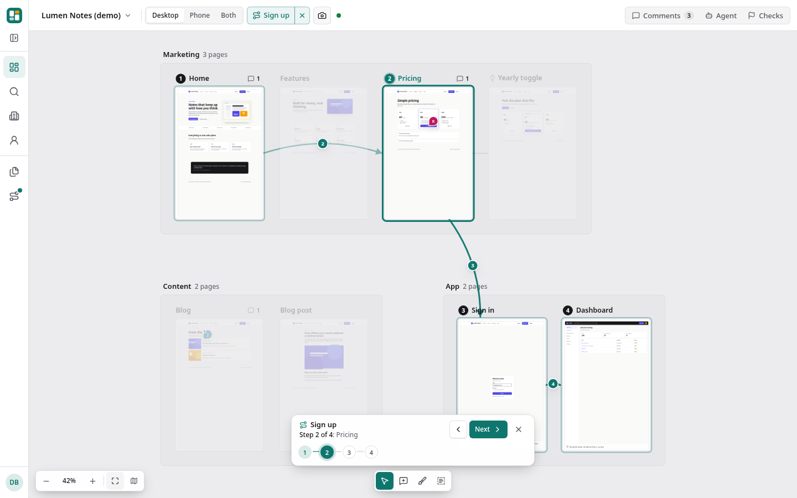

# Journeys and links

A board shows every page; a journey shows the path people take through them. "Sign up" is the home page, then pricing, then the sign-in
form, then the dashboard. Reviewing a journey step by step catches what reviewing pages one at a time misses: a button that promises
something the next page does not deliver, a step that looks different on a phone, a dead end.



## Links between pages

Every capture records which other configured pages each page links to. Turn on **Links** on the board to see them as arrows:

- With no card active, every link arrow is drawn, thin and quiet. On a big board (over 150 links) nothing is drawn until you hover or
  select a card, so the board stays readable.
- Hover a card (or tap it on a phone) to see only its own links: arrows going out in the accent color, arrows coming in in grey.

Only links to pages in your config count. A link matches a page when it points at the same origin, under the base URL's path, with the
same path (a trailing slash, `index.html` and repeated slashes do not matter) and the same query. A page without a query in the config
also matches links that add one (`/pricing?utm_source=nav`). Links are stored as page ids in the capture's `manifest.json`
(`pages.<id>.<viewport>.links`); the hrefs themselves are never stored or shown, since they come from the page under review.

## Journeys in the config

```json
{
  "pages": [
    { "id": "home", "path": "/" },
    { "id": "pricing", "path": "/pricing" },
    { "id": "login", "path": "/login" },
    { "id": "dashboard", "path": "/app" }
  ],
  "journeys": [
    {
      "id": "sign-up",
      "name": "Sign up",
      "description": "From the landing page to the first notes",
      "steps": ["home", "pricing", "login", "dashboard"]
    }
  ]
}
```

| Key           | Type   | Notes                                                          |
| ------------- | ------ | -------------------------------------------------------------- |
| `id`          | string | Lowercase letters, digits and dashes. Unique on the board.     |
| `name`        | string | Up to 120 characters. Shown in the picker and the journey bar. |
| `steps`       | array  | 2 to 50 page ids, in order, or forks (below). Repeats allowed. |
| `description` | string | Optional, up to 500 characters.                                |

In a multi-board config, put `journeys` inside each board. Journeys from the config are read-only on the board; change them in the file.

## Branches

Real flows fork: the email link works or has expired, the card is accepted or declined, the visitor is signed in or not. Instead of a
page id, any step after a page can be a fork:

```json
{
  "id": "sign-up",
  "name": "Sign up",
  "steps": [
    "home",
    "signup",
    {
      "branches": [
        { "id": "link-works", "label": "Link works", "steps": ["verify"] },
        { "id": "link-expired", "label": "Link expired", "steps": ["verify-expired", "verify"] },
        { "label": "Never clicks it", "steps": ["reminder-email"], "end": true }
      ]
    },
    "welcome",
    "dashboard"
  ]
}
```

| Key     | Type    | Notes                                                                                                   |
| ------- | ------- | ------------------------------------------------------------------------------------------------------- |
| `label` | string  | 1 to 60 characters. Shown on the arrow into the branch and on the button that picks it.                 |
| `id`    | string  | Optional; lowercase letters, digits and dashes, unique within the fork. Defaults to the label, slugged. |
| `steps` | array   | The branch's pages (and forks). Empty means "skip straight to the step after the fork".                 |
| `end`   | boolean | Optional. `true`: the journey stops at the end of this branch instead of rejoining.                     |

- Every branch rejoins at the step after the fork, unless it has `end: true`. In the example, both links lead on to `welcome`.
- A fork has 2 to 6 branches and follows a page (it cannot be the first step, or come right after another fork). Branches may fork
  again, up to 3 deep. If every branch ends, nothing may follow the fork.
- The 50-step limit counts the pages on every branch, and a journey allows at most 64 different paths through its forks.
- A list of plain page ids is a linear journey, exactly as before. Existing configs and `journeys.json` files need no migration; a
  journey branches as soon as one of its steps is a fork. Mistakes are reported with their JSON path, e.g.
  `journeys[0].steps[2].branches[1].label: 1 to 60 characters`.

## Journeys made on the board

Pick **New journey** in the toolbar's **Views** menu or the command palette (on a phone: the **...** menu), then click pages in the order people visit them. Name the
journey and save. Journeys made this way are stored in `.shapewall/<board>/journeys.json`, with the same atomic writes and file lock as
comments, and can be edited or deleted from the journey bar. If a page leaves the config, its steps drop out of the journey (a fork left
with one branch becomes that branch's steps).

The builder clicks out linear journeys. To make a board journey branch, send forked `steps` through the API; such a journey can be
deleted from the journey bar but not reopened in the builder, so a click cannot flatten its branches.

API (JSON only, refused in read-only mode):

```text
GET    /api/boards/:board/journeys                     { journeys: [{ id, name, description, steps, source, branching, pages, paths }] }
POST   /api/boards/:board/journeys       { name, steps, description? }   -> 201 { journey }
PATCH  /api/boards/:board/journeys/:id   { name?, steps?, description? } -> { journey }
DELETE /api/boards/:board/journeys/:id                                   -> { ok: true }
```

`source` is `config` or `board`; changing a config journey answers 409 `config_journey`. `steps` comes back as written, forks included.
Read from it: `branching` (whether any step forks), `pages` (every page on any branch, once each) and `paths`, every way through the
forks as `{ choices: [branch id per fork], labels, steps: [page ids], ended }`. A linear journey has one path.

The same structure is in `shapewall journeys --json`, the MCP tool `list_journeys`, and a static export (`data/boards/<board>.json` and
`data/boards/<board>/journeys.json`). `shapewall journeys` prints it as text, one step per line with each fork's branches indented.

## Stepping through

Open a journey from any of these; they all show the same one:

- **Views** in the toolbar: its **Journeys** group lists every journey with its steps (or paths), and **None** shows all pages again.
  With more than eight, the list scrolls and has a filter. While a journey is open the button shows its name, and its **x** leaves it.
- The sidebar: expanded, its **Pages | Journeys** switch; the **Journeys** tab lists **None** (show all pages) and every journey with
  its steps, the open one highlighted, a filter past eight and **New journey** where you can make one. The tab you chose is kept in this
  browser; opening a journey elsewhere does not switch it, but the **Journeys** tab shows a dot while one is open. Collapsed, the
  **Journeys** icon (with the same dot) opens that list beside the rail.
- The command palette (Ctrl/Cmd+K): type the journey's name.
- **J** opens the next journey, **Shift+J** the previous one; past the last one the board shows all pages again.
- On a phone: the **...** menu's **Journeys** group.

Selecting a journey highlights its pages with numbered badges, draws arrows between consecutive steps and fades everything else. The
journey bar steps through it:

- **Previous / Next** buttons (full-width on a phone), or the left and right arrow keys.
- Each step flies the camera to that page.
- Back (the browser's, or Android's) closes the journey, like every other overlay on the board.
- **Only <journey>** in the comments panel narrows the comments to the journey's pages, on every branch.

In a branching journey you step through one path at a time, the first branch of each fork unless you pick another:

- Arrows on the current path are numbered, and the arrow into a branch carries its label ("3 Link expired"). The branches not taken
  are drawn dashed with their label, and their pages stay half visible with a dashed outline instead of fading out.
- At a step where the journey forks, the bar asks **Which way?** with a button per branch (a branch that ends the journey says so).
  Next follows the branch picked; picking another one at an earlier fork resets the later ones to their first branch.
- The step line shows the branch you are on ("Step 4 of 8 (Link expired): Verify: link expired"), and the total follows the path.

The journey, the branches picked and the step live in the URL (`?j=sign-up&jb=link-expired&step=4`), so a link opens the same step on
the same path. `jb` lists the branch id taken at each fork reached, in order.
